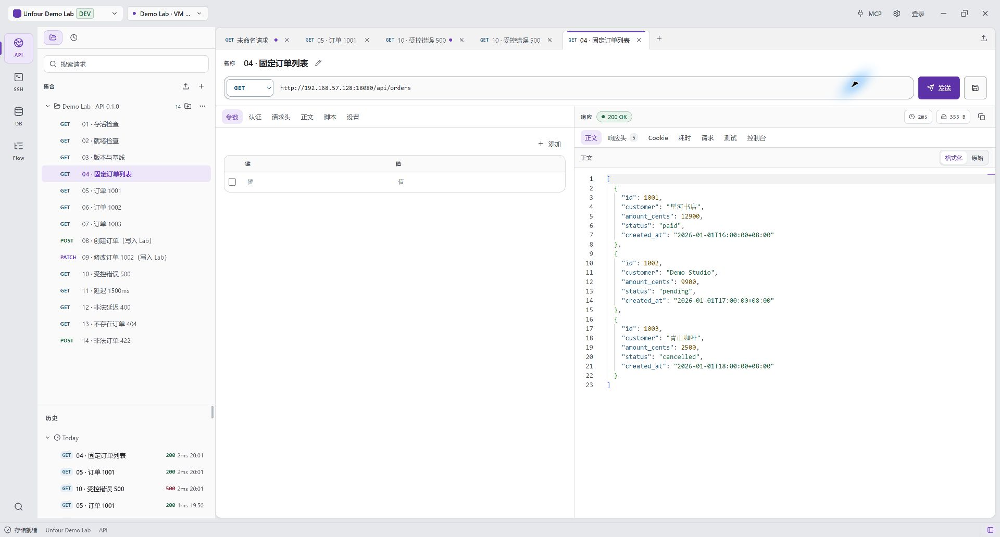
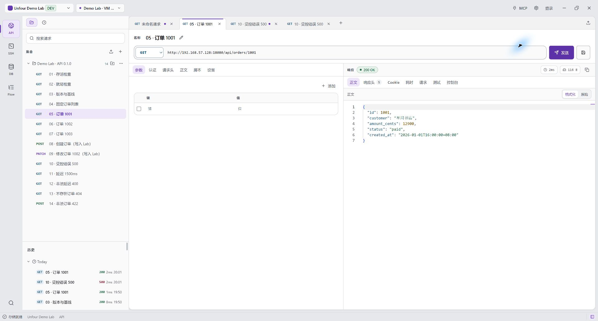
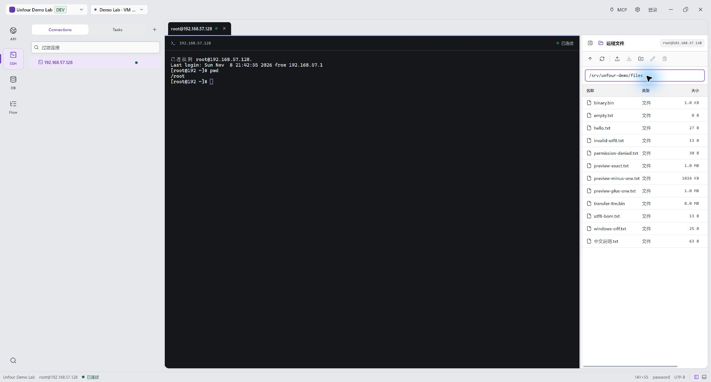
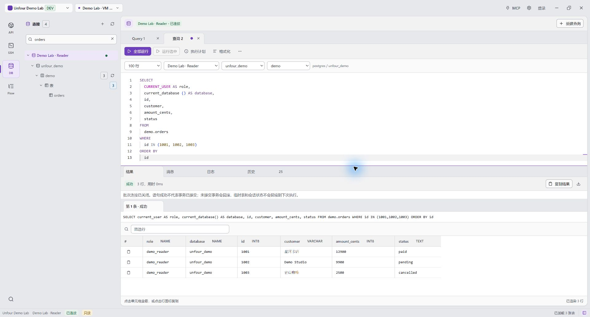
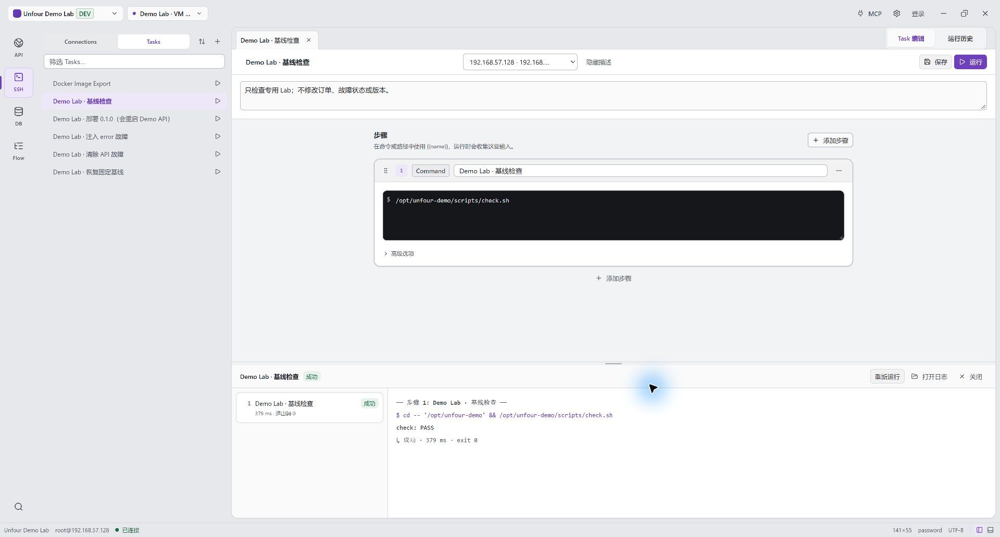
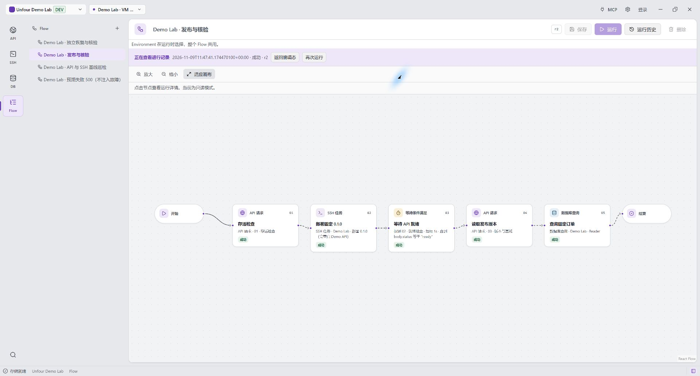

<div align="center">

[English](README.md) · [简体中文](README.zh-CN.md)

# Unfour

**A unified, local-first developer workspace for tracing backend failures from API requests through server logs and database state to verified fixes.**

Unfour brings API testing, SSH, database tools, local Flow runbooks, and MCP-assisted troubleshooting into one desktop application.

[](LICENSE)
[](https://github.com/zyqzyq/Unfour/actions/workflows/ci.yml)
[](https://github.com/zyqzyq/Unfour/releases/latest)
[](https://tauri.app)



</div>

## Download

[Download the latest stable release](https://github.com/zyqzyq/Unfour/releases/latest) ·
[Changelog](CHANGELOG.md)

- Windows x64 is the primary distribution. The NSIS `.exe` installer is unsigned
  and may trigger SmartScreen or other operating-system security warnings.
- macOS offers `.dmg` installers for Apple Silicon (arm64) and Intel (x64).
  The installers are unsigned and unnotarized, so Gatekeeper may block them.
- Linux is Experimental and targets Ubuntu 22.04+. The x86_64 (x64) AppImage
  is the only published Linux package.
- Verify downloaded installers with the release `SHA256SUMS.txt` asset.

## What Is Unfour?

Unfour helps backend developers investigate failures that span an API, a
server, and its database. Troubleshooting is Unfour's core product loop:
reproduce an issue with an API request, inspect server logs over SSH, check
database state, identify the cause, and make and verify a fix.

A unified, local-first workspace keeps requests, connections, local activity,
and layout together throughout the investigation. API testing, SSH terminals,
and database tools provide the capabilities for each step in that loop. Flow
combines those capabilities into local runbooks for repeatable checks and tasks.
Flow definitions are included in whole-Workspace import/export and the current
Pro Cloud Sync client. Execution and run history stay on the device. Flow is a
runbook for this workspace, not a general workflow platform.

MCP is an optional assisted layer: Codex and Cursor can use the local stdio
MCP server to work with the same saved API, SSH, database, and Flow data as
the desktop app. Its workspace-scoped tools run through the shared command
bus, subject to MCP policy and high-risk action confirmation checks.
MCP can save, run, cancel, and query Flows. It does not generate a
troubleshooting playbook, correlate requests with logs and database state, or
detect root causes. You author and start runbooks. Boundaries and confirmation
are in the [MCP overview](docs/mcp/overview.md).

Unfour is one application and one product. Its core desktop features are free
and open source under Apache-2.0. An active Pro subscription unlocks Cloud Sync
in the same application. Pro is an entitlement within Unfour, not a separate
client, package, repository, or release.

The app is built with Tauri 2, React, TypeScript, and Rust. The frontend owns
the workbench UI, while security-sensitive execution such as HTTP, SSH,
database drivers, local storage, and credential references lives behind Rust
capability crates and the command bus.

## Troubleshooting Workflow

```text
API error
↓
Inspect server logs over SSH
↓
Check related database state
↓
Identify the cause
↓
Repeat the request and verify the fix
```

The investigation stays in one workspace, while you remain in control of each
request, SSH session, query, and verification step.

## For Coding Agents

Codex or Cursor can use their own repository tools to inspect, change, and test
code. Unfour complements those tools with controlled access to API behavior,
SSH/server evidence, and database state through MCP, so the agent can help
investigate the running backend and re-check it after a change.

Unfour does not edit the repository itself: the coding client owns code changes,
while Unfour provides the runtime side of the investigation. You control the
workspace, environment, risky actions, and final decision.

## Modules

- **API Client** - Compose and send HTTP requests, organize saved requests into
  collections and folders, resolve shared workspace variables, inspect response
  body/headers/cookies/timing, run saved pre-request and post-response scripts,
  review script tests and console output, keep redacted history, and import or
  export collections and environments.
- **SSH Terminal** - Manage SSH connections and terminal sessions (split panes,
  search, clipboard context menu, persistent redacted command history and
  typing suggestions, host-key trust, redacted logs), browse and
  transfer remote files over SFTP on ordinary SSH connections, and automate
  multi-step SSH tasks (command, upload, download) from the Connections /
  Files / Tasks sidebar.
- **Database** - Manage database connections, browse schemas, run SQL with
  confirmation-aware safety checks (including multi-statement Run All /
  Run Selected), preview and edit table rows, review query output, and export
  table structure as SQL and data as SQL, CSV, or JSON.
- **Flow** - Compose saved API requests, SSH tasks, and Database queries into
  local runbooks with Condition branches and Wait Until checks. Author them on
  the Canvas and inspect step results and run history. Definitions travel with
  a whole-Workspace import or export and the current Pro Cloud Sync client.
  Only definitions sync; run history and actual runtime inputs/outputs remain
  local. Detailed manual acceptance is tracked separately. See
  [Flow V1](docs/architecture/flow-v1.md).
- **Workspace** - Scope saved requests, shared environments/variables,
  connections, activity, tabs, and layout state to a local workspace, with
  title-bar active-environment switching. Export/import whole Workspace
  definitions, including Flow definitions, or create a password-encrypted local
  backup with optional saved credentials. Import previews create independent
  copies. See
  [Workspace exchange and backups](docs/user/USER_GUIDE.md#workspace-exchange-and-local-backups).
- **MCP integration for Codex and Cursor** - Expose local stdio tools through
  the same command bus used by the desktop app. Codex and Cursor can use the
  same saved API, SSH, and database connections to reproduce issues, inspect
  logs and database state, and verify a fix. They can also save, run, cancel,
  and query local Flows under the same safety checks. MCP does not generate a
  troubleshooting playbook. See the [MCP overview](docs/mcp/overview.md).

> [Connect Codex and Cursor to Unfour MCP →](docs/mcp/client-setup.md)

Encrypted backups are local files, separate from Pro Cloud Sync. A Workspace
export includes Flow definitions and omits run history. The current client syncs
Flow definitions with a 64 KiB payload limit, including input declarations and
ordinary defaults, but excludes actual runtime inputs/outputs, history and
credentials. Recognized sensitive/device-local material is rejected; arbitrary
secrets in free text cannot be reliably detected. Keep secrets in runtime secret
inputs or resource credential storage. Backups do not embed database or
private-key files. Review free-form scripts and SQL before sharing or syncing.

Cloud Sync refreshes saved data in already-open modules and the workspace
switcher after remote changes commit locally, while preserving drafts and
execution state. SSH Tasks support reviewed reruns and previous-parameter recall,
with shared English/Chinese feedback and retry for loading/refresh failures.
Database MCP calls bind policy and execution to one workspace per call; guarded
UPDATE/DELETE confirmation checks the parsed outer WHERE.

## Screenshots

Captured in Unfour v0.14.0 on Windows using synthetic data in the Demo Lab.

**App overview — API collection and the three baseline orders**


**API Client — order 1001 returned by the live Demo API**



**SSH Terminal — connected Lab session and SFTP sample files**



This session uses the saved Lab root connection. It does not demonstrate
ordinary-account SFTP permissions or transfer acceptance.

**Database — read-only role querying the same three baseline orders**



**SSH Task — saved baseline check, completed with exit code 0**



**Flow — API health, SSH deployment, readiness, version, and database query**



## Local Development

Requirements:

- Node.js and pnpm.
- A stable Rust toolchain.
- Tauri 2 prerequisites for your operating system.

Install and run:

```bash
pnpm install
pnpm tauri dev
```

`pnpm install` also installs Git hooks through lefthook. A commit formats staged
Rust files with `cargo fmt` and auto-fixes staged TypeScript with ESLint.
Skip once with `LEFTHOOK=0 git commit`.

Common commands:

```bash
pnpm tauri build        # create local Stable-channel Tauri bundles
pnpm tauri build:test   # create isolated Test-channel Tauri bundles
pnpm run build          # build the desktop frontend only
pnpm run check          # frontend build + Rust check + large-file check
pnpm run lint           # ESLint
pnpm run test           # frontend unit tests (Vitest)
pnpm run test:e2e       # Playwright smoke tests
pnpm run check:rust     # cargo check --workspace
pnpm run check:rust:ssh # cargo check with the ssh-native feature
pnpm run test:rust      # cargo test --workspace
pnpm run test:release-env # release/channel contract unit tests
```

Run commands from the repository root unless a package document says otherwise.
`pnpm tauri dev` defaults to the Test release channel, while local
`pnpm tauri build` defaults to Stable. Use `pnpm tauri build:test` for an
isolated Test-channel bundle. Set `UNFOUR_STORAGE_PROFILE=dev` when development
data should use `~/.unfour-dev`; this storage override is independent from
release identity. Only CI should create formal publishable Stable artifacts,
with `UNFOUR_RELEASE_CHANNEL=stable` and an exact `UNFOUR_BUILD_COMMIT`.

## Project Layout

| Path | Role |
| --- | --- |
| `apps/desktop` | Tauri/Vite desktop app entry and Tauri adapter layer. |
| `packages/app-shell` | Global shell composition and module mount slots. |
| `packages/api-client` | API Client frontend module. |
| `packages/ssh-terminal` | SSH Terminal frontend module. |
| `packages/database` | Database frontend module. |
| `packages/flow` | Local Flow runbook editor, Canvas, and run history. |
| `packages/workspace-core` | Shared frontend workspace state. |
| `packages/workspace-environments` | Workspace environments and variables management UI. |
| `packages/workspace-local` | Local workspace lifecycle and whole-Workspace import/export UI. |
| `packages/ui` | Shared UI primitives and stateless layout helpers. |
| `packages/command-client` | Typed Tauri command wrappers and frontend command types. |
| `crates/*` | Rust backend capability crates and adapters. |

See `docs/architecture/project-structure.md` for the full package and crate
map.

## Documentation

Read the document that owns the question. The README stays usable on its own;
the links below are the detailed sources.

| Question | Document |
| --- | --- |
| How do I use the app? | [User guide](docs/user/USER_GUIDE.md) |
| What can MCP do, and what must be confirmed? | [MCP overview](docs/mcp/overview.md) |
| How do I connect Codex or Cursor? | [Client setup](docs/mcp/client-setup.md) |
| What does a tool accept and return? | [MCP tools](docs/mcp/tools.md) |
| How do I build the MCP server? | [Codex setup](docs/mcp/codex-setup.md) |
| What shipped, and what is only planned? | [Roadmap](docs/roadmap.md) |
| Where are the release notes? | [GitHub release notes](https://github.com/zyqzyq/Unfour/releases) |
| How are releases verified? | [Release verification](docs/testing/release-verification.md), [release checklist](docs/release/release-checklist.md) |
| How is the repository split? | [Package boundaries](docs/architecture/package-boundaries.md), [project structure](docs/architecture/project-structure.md) |
| How are secrets and local data stored? | [Data storage](docs/architecture/data-storage.md), [security model](docs/architecture/security-model.md) |
| How do Flow and Workspace exchange work? | [Flow V1](docs/architecture/flow-v1.md), [Workspace bundle](docs/architecture/workspace-bundle.md) |

`AGENTS.md` and `docs/agents/START_HERE.md` are for coding agents working in
this repository. `docs/architecture/diagnostics.md` covers local logs and
diagnostic bundles.

## Contributing

Please read `CONTRIBUTING.md`, `CODE_OF_CONDUCT.md`, and the package boundary
rules in `AGENTS.md` before opening a pull request.

Security issues should be reported through `SECURITY.md`, not a public issue.

## Support Unfour

If Unfour is useful to you, you can support its continued open-source development through [GitHub Sponsors](https://github.com/sponsors/zyqzyq).

Sponsorship is optional and does not include Unfour Pro or paid cloud services.

## Why Unfour?

The name “Unfour” is partly inspired by the Chinese idea of **四不像** — something that doesn’t quite fit into any single category.

Unfour isn’t just an API client, an SSH tool, a database client, or an agent workspace. It brings those usually separate capabilities together, so the name carries a bit of self-deprecating humor: it’s not quite any one of them, but has a little of each.

In traditional Chinese mythology, 四不像 is also associated with an auspicious mythical creature. That gave the name another meaning for me — a small hope that Unfour can grow into something a little unusual, but genuinely useful and built to last.

## License

Licensed under the [Apache License 2.0](LICENSE).
