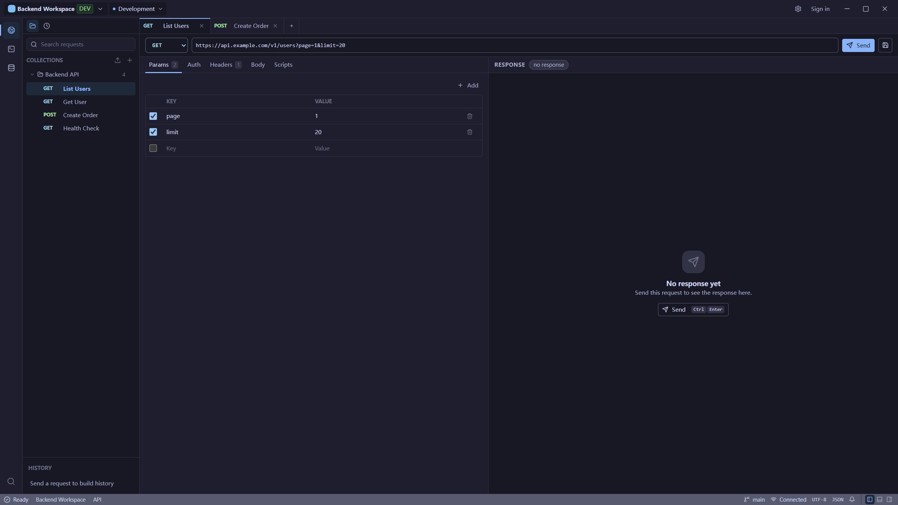
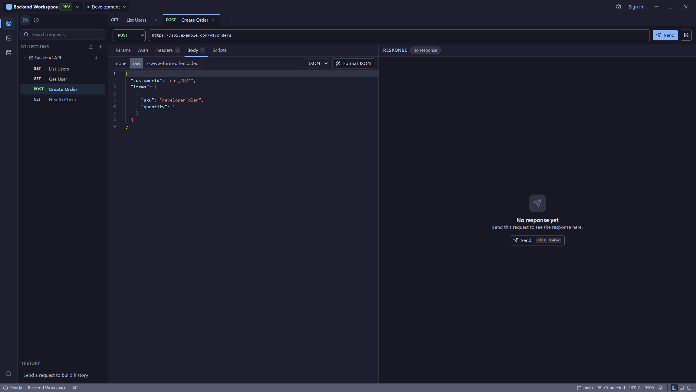
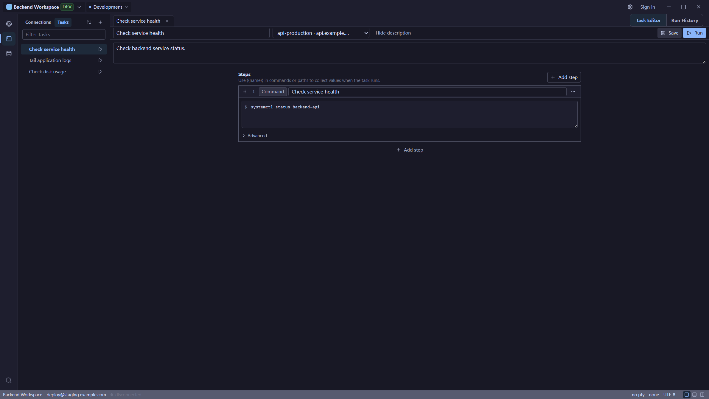
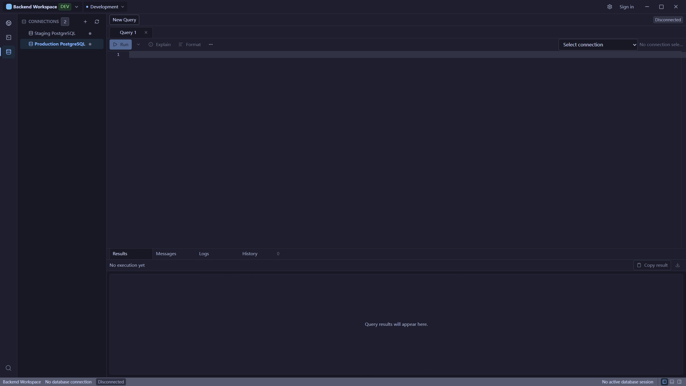

<div align="center">

[简体中文](README.zh-CN.md) · [English](README.md)

# Unfour

**一个统一、本地优先的开发者工作区，用于从 API 请求一路追踪后端故障到服务器日志、数据库状态和修复验证。**

Unfour 在一个桌面应用中提供 API 测试、SSH、数据库工具、本地 Flow runbook 和 MCP 辅助排障能力。

[](LICENSE)
[](https://github.com/zyqzyq/Unfour/actions/workflows/ci.yml)
[](https://github.com/zyqzyq/Unfour/releases)
[](https://tauri.app)



</div>

> [!WARNING]
> Unfour v0.11.0 已于 2026-10-10 正式发布。产品统一为 Unfour。
> Windows NSIS 安装包尚未签名，可能触发 SmartScreen 或其他操作系统安全警告。
> 请使用 GitHub Release 中的 `SHA256SUMS.txt` 校验下载文件。

请参阅 [v0.11.0 变更记录](CHANGELOG.md#0110---2026-10-10)、
[Release Notes](docs/release/v0.11.0-release-notes.md)及
[正式发布验证记录](docs/testing/release-verification.md#v0110-final-release-verification-record)。

当前 `main` 正在准备 **v0.12.0**，尚未发布，也未完成 RC 验收。当前客户端已启用
Flow Definition Cloud Sync；已部署服务端兼容性和真实双设备验收均为 **NOT VERIFIED**。
请参阅[发布说明草稿](docs/release/v0.12.0-release-notes.md)和
[验证清单](docs/testing/v0.12.0-rc-checklist.md)。下文能力描述基于当前源码；
v0.11.0 下载版本不包含 Flow Cloud Sync。

## 下载

请从 [GitHub Releases](https://github.com/zyqzyq/Unfour/releases/latest) 下载最新的 Unfour 正式版本。

- Windows 是主分发路径：NSIS `.exe` 安装包。该安装包尚未签名，可能触发
  SmartScreen。
- macOS 提供 Apple Silicon 与 Intel 包；v0.9.0 已记录真机安装运行验证，但未 Apple 签名、未公证；
  Gatekeeper 可能拦截。
- Linux 目前只发布 x86_64（x64）AppImage，定位为 Experimental（实验性），
  当前面向 Ubuntu 22.04+，不支持 Ubuntu 20.04。已发布的 v0.9.0 AppImage
  早于本次构建基线修复，新产物仍待真实运行验证。`.deb` 和 `.rpm` 暂不正式支持，
  也不会公开发布。
- 使用 Release 中的 `SHA256SUMS.txt` 校验下载的安装包。

## Unfour 是什么？

Unfour 帮助后端开发者排查涉及 API、服务器及其数据库的故障。排障是 Unfour 的核心产品闭环：
通过 API 请求复现问题，经由 SSH 检查服务器日志，查看数据库状态，定位原因，再进行修复并验证。

统一、本地优先的工作区让请求、连接、本地活动和布局贯穿整个排查过程。
API 测试、SSH 终端与数据库工具为这条链路中的各个步骤提供能力。Flow 将这些能力组合成
本地 runbook，用于重复执行检查与任务。Flow 定义包含在工作区整体导入导出和当前
Pro Cloud Sync 客户端中；执行与运行历史留在本机。Flow 是工作区内的 runbook，
不是通用工作流平台。

MCP 是可选的辅助层：Codex 与 Cursor 可以通过本地 stdio MCP 服务，使用与桌面应用相同的
已保存 API、SSH、数据库和 Flow 数据。工具限定在工作区范围内，经由共享命令总线执行，并遵循
MCP 策略和高风险操作确认检查。MCP 可以保存、运行、取消和查询 Flow，
但不会自动生成排障剧本，也不会自动关联请求、日志与数据库状态或检测根因。
用户编写并启动 runbook。能力边界与确认机制见 [MCP 概述](docs/mcp/overview.md)。

Unfour 是一个统一的应用和产品。核心桌面功能免费并以 Apache-2.0 协议开源。
用户可通过有效的 Pro 订阅在同一个应用中解锁 Cloud Sync。Pro 是 Unfour 内的订阅权益，
不是独立的客户端、安装包、仓库或发布版本。

应用基于 Tauri 2、React、TypeScript 与 Rust 构建。前端负责工作台界面，而 HTTP、SSH、
数据库驱动、本地存储与凭据引用等安全敏感的执行逻辑，则位于 Rust 能力模块与命令总线之后。

## 排障工作流

```text
API 错误
↓
通过 SSH 检查服务器日志
↓
检查相关数据库状态
↓
定位问题原因
↓
重新发送请求并验证修复
```

整个排查过程都留在同一个工作区中，但每个请求、SSH 会话、查询和验证步骤仍由用户主动选择。

## 面向 Coding Agent

Codex 或 Cursor 可以继续使用自己的仓库工具阅读、修改和测试代码。Unfour 通过 MCP
提供受控的 API 行为、SSH / 服务器证据和数据库状态访问，补充这些工具的能力，
帮助 Agent 排查正在运行的后端，并在修改后重新检查。

Unfour 本身不修改代码仓库：代码变更由 Coding 客户端负责，Unfour 提供排查中的运行时信息。
工作区、环境、高风险操作和最终决策仍由用户控制。

## 模块

- **API Client（API 客户端）** - 编写并发送 HTTP 请求，将已保存的请求整理为集合与
  文件夹，解析共享工作区变量，检查响应体 / 请求头 / Cookie / 耗时，运行已保存的请求前与
  响应后脚本，查看脚本测试和控制台输出，保留经过脱敏的历史记录，并导入导出集合与环境。
- **SSH Terminal（SSH 终端）** - 管理 SSH 连接与终端会话（分屏、搜索、主机密钥信任、
  剪贴板右键菜单、持久化的脱敏命令历史与输入建议、脱敏日志），通过 SFTP 浏览与传输
  远程文件，并在 Connections / Files / Tasks 侧栏中编排多步骤 SSH 任务（命令、上传、下载）。
- **Database（数据库）** - 管理数据库连接，浏览 Schema，在带确认的安全检查下运行
  SQL（支持多语句全部运行 / 运行选中），预览与编辑表数据，查看查询结果，并导出表结构与数据：
  结构使用 SQL，数据支持 SQL、CSV 与 JSON。
- **Flow** - 将已保存的 API 请求、SSH 任务与 Database 查询组合成本地 runbook，支持
  Condition 分支与 Wait Until 检查。通过 Canvas 编排步骤，查看步骤结果与运行历史。
  定义随工作区整体导入导出转移，也参与当前 Pro Cloud Sync 客户端的同步。
  仅同步定义，运行历史及实际运行输入、输出留在本机；真实双设备验收为 **NOT VERIFIED**。详见
  [Flow V1](docs/architecture/flow-v1.md)。
- **Workspace（工作区）** - 将已保存的请求、共享环境变量、连接、活动、标签页与布局状态
  限定在某个本地工作区之内，并支持标题栏切换当前环境。可整体导入导出工作区定义（含 Flow
  定义），或创建可选包含已保存凭据的密码加密本地备份；导入预览确认后创建独立副本。请参阅
  [工作区交换与备份说明](docs/user/USER_GUIDE.md#workspace-exchange-and-local-backups)。
- **MCP integration（面向 Codex 与 Cursor）** - 通过桌面应用所用的同一命令总线，
  以本地 stdio 方式提供工具。Codex 与 Cursor 可以使用同一套已保存的 API、SSH 与数据库
  连接来复现问题、查日志、查数据库状态并验证修复，也可以保存、运行、取消和查询本地 Flow，
  并沿用相同的安全检查。MCP 不会自动生成排障剧本。详见
  [MCP 概述](docs/mcp/overview.md)。

> [连接 Codex 与 Cursor 到 Unfour MCP →](docs/mcp/client-setup.md)

加密备份是本地文件，与 Pro Cloud Sync 分开。工作区导出包含 Flow 定义、不含运行历史。
当前客户端同步 Flow 定义（含输入声明和普通默认值），云端载荷上限为 64 KiB；实际运行输入、
输出、历史和凭据不参与同步。可识别的敏感字段及设备本地材料会被拒绝，但无法可靠识别
任意自由文本中隐藏的秘密。请使用运行时 Secret 输入或资源凭据存储。备份不嵌入数据库文件
或私钥文件。分享或同步前，仍需检查脚本、SQL 等自由文本中的硬编码凭据。

## 截图

**应用总览 — 左侧模块切换栏与 API Client 工作台**


**API Client — 含 Params / Auth / Headers / Body 的请求构造器与响应区**



**SSH 终端 — 连接、会话、远程文件与任务**



**数据库 — Schema 浏览与 SQL 查询输出**



## 本地开发

环境要求：

- Node.js 与 pnpm。
- 稳定的 Rust 工具链。
- 对应操作系统的 Tauri 2 前置依赖。

安装与运行：

```bash
pnpm install
pnpm tauri dev
```

`pnpm install` 会通过 lefthook 安装 Git hooks。提交时会对暂存的 Rust 文件执行
`cargo fmt`，并对暂存的 TypeScript 执行 ESLint `--fix`。
如需跳过一次，使用 `LEFTHOOK=0 git commit`。

常用命令：

```bash
pnpm tauri build        # 生成使用 Stable 数据目录的 Tauri 安装包
pnpm tauri build:test   # 生成使用 Test 隔离数据目录的 Tauri 安装包
pnpm run build          # 仅构建桌面前端
pnpm run check          # 前端构建 + Rust 检查 + 大文件检查
pnpm run lint           # ESLint
pnpm run test           # 前端单元测试（Vitest）
pnpm run test:e2e       # Playwright 冒烟测试
pnpm run check:rust     # cargo check --workspace
pnpm run check:rust:ssh # 启用 ssh-native 特性的 cargo check
pnpm run test:rust      # cargo test --workspace
```

除非某个包的文档另有说明，否则请从仓库根目录运行上述命令。
`pnpm tauri dev` 默认使用 Test 通道，`pnpm tauri build` 默认使用 Stable 通道，
需要隔离数据的本地测试安装包请使用 `pnpm tauri build:test`。本地 Stable 构建不等于
经过 CI 验证的正式发布产物；正式发布仍须显式提供 `UNFOUR_RELEASE_CHANNEL=stable`
和准确的 `UNFOUR_BUILD_COMMIT`。

## 项目结构

| 路径 | 职责 |
| --- | --- |
| `apps/desktop` | Tauri/Vite 桌面应用入口与 Tauri 适配层。 |
| `packages/app-shell` | 全局外壳组合与模块挂载槽位。 |
| `packages/api-client` | API Client 前端模块。 |
| `packages/ssh-terminal` | SSH Terminal 前端模块。 |
| `packages/database` | Database 前端模块。 |
| `packages/flow` | 本地 Flow runbook 编辑器、Canvas 与运行历史。 |
| `packages/workspace-core` | 共享前端工作区状态。 |
| `packages/workspace-environments` | 工作区环境与变量管理 UI。 |
| `packages/workspace-local` | 本地工作区生命周期与整体导入导出界面。 |
| `packages/ui` | 共享 UI 基础组件与无状态布局辅助。 |
| `packages/command-client` | 类型化的 Tauri 命令封装与前端命令类型。 |
| `crates/*` | Rust 后端能力模块与适配器。 |

完整的包与模块（crate）映射请参阅 `docs/architecture/project-structure.md`。

## 发布状态

[Unfour v0.11.0](https://github.com/zyqzyq/Unfour/releases/tag/v0.11.0) 已于
2026-10-10 作为 Standard stable 版本正式发布。CI、Standard Release Candidate、
Standard Release、发布资产、checksums 以及在线 updater/download manifests 已验证。
没有 v0.11.0 实际证据的平台、真实服务与人工回归继续保持 `NOT VERIFIED`。
早期版本及 v0.11.0 RC 准备记录保留其历史范围。产品统一为 Unfour。
发布验证证据见：

- `docs/testing/release-verification.md`
- `docs/testing/manual-test-cases.md`
- `docs/release/release-checklist.md`
- `docs/release/distribution.md`
- `docs/release/signing.md`

Windows 是主分发路径，提供尚未签名的 NSIS `.exe` 安装包，可能触发 SmartScreen。
macOS 提供 Apple Silicon 与 Intel 包，v0.9.0 已记录真机验证，但未 Apple 签名、未公证，
Gatekeeper 可能拦截。Linux 目前只发布 x86_64（x64）AppImage，定位为 Experimental
（实验性），当前运行与测试基线为 Ubuntu 22.04+，不支持 Ubuntu 20.04；不能仅凭
glibc 版本就保证其他发行版兼容。`.deb` 和 `.rpm` 暂不正式支持，也不会公开发布。
请使用 Release 中的 `SHA256SUMS.txt` 校验下载的产物。除非发布检查确实成功执行，或有当前仓库证据支撑，
否则不得声称其通过。

已发布的 v0.9.0 Linux AppImage 构建成功，但因依赖 Ubuntu 24.04 时代的
GLIBC/GLIBCXX 符号，在 Ubuntu 20.04 上启动失败。v0.11.0 AppImage 已使用
Ubuntu 22.04 构建，不会替换已发布的 v0.9.0 文件。在记录已发布产物的实际运行测试前，
v0.11.0 Ubuntu 22.04/24.04 运行回归仍为 `NOT VERIFIED`，详见
[发布验证记录](docs/testing/release-verification.md#linux-appimage-compatibility)。

早期版本的真机与人工结果，以及仍然保持 `NOT VERIFIED` 的检查，集中记录在
[发布验证](docs/testing/release-verification.md)。该记录中，下列 v0.11.0 事项仍为
`NOT VERIFIED`：原生安装与更新、已发布产物上的工作区 / Auth / 数据库 / MCP / Flow
回归、账号 / Cloud Sync 与 MCP 生产策略旅程、Linux 运行、macOS 与 Linux 凭据存储，
以及人工 MSIX / Store 路径。正式发布不会把这些事项改成 `PASS`。v0.9.0 的平台结果
保留其原始范围。

## 文档

按问题查阅对应文档。本 README 可以单独阅读；下表是进一步说明的权威来源。

| 问题 | 文档 |
| --- | --- |
| 如何使用应用？ | [用户指南](docs/user/USER_GUIDE.md) |
| MCP 能做什么，哪些操作需要确认？ | [MCP 概述](docs/mcp/overview.md) |
| 如何连接 Codex 或 Cursor？ | [客户端配置](docs/mcp/client-setup.md) |
| 工具接受什么参数、返回什么结果？ | [MCP 工具](docs/mcp/tools.md) |
| 如何构建 MCP 服务？ | [Codex 开发配置](docs/mcp/codex-setup.md) |
| 已发布什么，哪些只是计划？ | [路线图](docs/roadmap.md) |
| 哪些发布检查已通过？ | [发布验证](docs/testing/release-verification.md) |
| 仓库如何划分？ | [包边界](docs/architecture/package-boundaries.md)、[项目结构](docs/architecture/project-structure.md) |
| 密钥与本地数据如何存储？ | [数据存储](docs/architecture/data-storage.md)、[安全模型](docs/architecture/security-model.md) |
| Flow 与工作区交换如何工作？ | [Flow V1](docs/architecture/flow-v1.md)、[工作区包](docs/architecture/workspace-bundle.md) |

`AGENTS.md` 与 `docs/agents/START_HERE.md` 面向在本仓库中工作的编码 Agent。
`docs/release/release-checklist.md` 是公开发布检查清单。
`docs/architecture/diagnostics.md` 说明本地日志与诊断包。

## 参与贡献

在提交 Pull Request 前，请先阅读 `CONTRIBUTING.md`、`CODE_OF_CONDUCT.md` 以及
`AGENTS.md` 中的包边界规则。

安全问题请通过 `SECURITY.md` 反馈，不要使用公开 Issue。

## 为什么叫 Unfour？

“Unfour” 这个名字有一点来自中文里的 **四不像**。

它不是单纯的 API Client，也不只是 SSH、数据库工具或 Agent 工作区。Unfour 把这些原本分散的能力放到一起，所以这个名字里也带着一点自嘲：不太像其中任何一个，但又都有一点。

而在中国传统神话想象里，四不像也是一种带有吉祥意味的神兽。给产品起这个名字时，也多少带着一点这样的期许——希望它最后能长成一个虽然有点特别，但真正有用、也能走得长远的东西。


## 许可证

基于 [Apache License 2.0](LICENSE) 开源。
