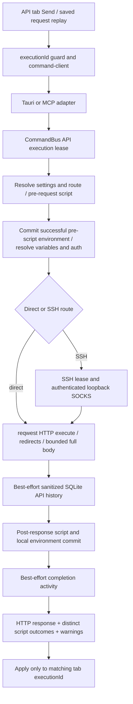

# API execution lifecycle audit — 2026-11-15

Base: `main`, `adbb553641b733d9223c9b21b8f3b92b66bfe573`. This report covers the
API engine, command bus and desktop API state. See
[combined audit](execution-lifecycle-audit-2026-11-15.md) for MCP and Flow propagation.
No new execution framework, persistent status enum, schema migration or retry policy
was introduced. The original untracked DSH architecture document was untouched.

## Execution chain

Cancellation drops the local HTTP receive future. It is not a remote rollback.
The HTTP deadline covers connection, redirect and complete body receive; SSH setup
consumes the same budget. History, scripts and activity are outside that network
deadline. Script runtime has its own bounded execution. A cancelled script's
blocking worker can finish in the sandbox, but discarded output is not committed.

## State contract (existing representation, with scoped corrections)

These are domain observations, not a proposed shared state machine. HTTP status
is authoritative only for the response received; a 2xx response is not proof of
every business-level invariant, and a 5xx does not prove absence of side effects.

| Phase / event | Existing representation | Result after this audit | Retry rule |
| --- | --- | --- | --- |
| Initial | tab idle / unsaved / saved | unchanged | Explicit Send |
| Running | `sending`, execution lease keyed by ID | unchanged; same live ID is rejected | Do not duplicate active send |
| Complete HTTP response | `ApiResponse` with status, body, snapshot | unchanged | Explicit new execution only; consider remote operation semantics |
| HTTP 4xx/5xx | Response retained; desktop `http-error` / failed badge | unchanged | Investigate response; do not assume no write occurred |
| Validation / pre-script failure | `Err` or pre-script failed/timeout, response absent | unchanged; HTTP not started | Correct inputs/script first; successful pre-script environment changes may already exist |
| SSH authentication / route validation / setup failure | `SSH_TUNNEL_*` before HTTP | unchanged | Correct route/trust; no HTTP replay required to repair history |
| Redirect target connect failure / temporary tunnel lost | Can use `SSH_TUNNEL_TARGET_UNREACHABLE` or `SSH_TUNNEL_TEMPORARY_UNAVAILABLE` after HTTP began | Preserve code; desktop warns remote effects may exist | Check original target before reissuing writes |
| Cancel before dispatch | `API_CANCELLED`, no response | unchanged; no HTTP execution | Explicit send allowed once cancellation completes |
| Cancel while network is active | `API_CANCELLED`, no response | code unchanged; desktop explains remote uncertainty | Check server before repeating writes |
| HTTP deadline expires | `API_TIMEOUT`, no response | code unchanged; local receive stopped, remote termination unconfirmed | Check server; not a proven remote failure or proven terminated timeout |
| Connection/body loss or body-size rejection | `NETWORK_ERROR`, `HTTP_ERROR`, `API_RESPONSE_TOO_LARGE` | no false successful response; uncertainty explanation | Check server; no unconditional retry |
| History insert failure after complete response | Previously `Err(Database)`, response lost | Response retained, `historyId: ""`, `API_HISTORY_RECORD_FAILED` warning | Never resend to repair local history |
| Cancel while writing history | Previously response discarded as cancelled | Response and eventual history result retained | Do not resend |
| Post-script runtime error/timeout | Response retained; post-script failed/timeout | unchanged | Fix script; rerunning request may repeat remote operation |
| Post-script preparation/local environment commit fails | Previously `?` discarded response | Response retained; post-script failed with `API_POST_RESPONSE_FINALIZATION_FAILED` | Do not resend to repair local state |
| Cancel during post-script preparation/execution | Previously response plus `API_CANCELLED` made HTTP tab appear cancelled | HTTP remains complete; `API_POST_RESPONSE_CANCELLED`, unfinished post result skipped | Check local script state; no implied remote cancellation |
| Completed post script and cancel ready together | No explicit completed-result preference | Completed script diagnostics retained; pending environment commit is skipped with `API_POST_RESPONSE_CANCELLED` | No automatic replay |
| Cancel after post environment persistence starts | Initial audit correction could discard an already committed result while cleanup waited | Await persistence outcome and retain post-script status, console and tests | No automatic replay; cancellation does not undo committed changes |
| Activity write fails | `ACTIVITY_RECORD_FAILED` warning | preserved and merged with history warnings | Never resend to repair activity |
| Late result | Tab applies only matching `executionId` | unchanged, regression verified | Does not overwrite newer execution |
| Run / Send again after terminal result | New ID, new HTTP execution | unchanged | User-directed; not an idempotency guarantee |

`historyId` remains a serialized string for compatibility. The empty string means
there is no saved history row; it is never fabricated into a clickable history
reference. Completion activity uses no target in that case. Existing records are
not changed. The warning vector already existed and now accumulates both sinks'
warnings instead of replacing engine warnings.

## Findings and reproduction evidence

### P1 API-1: local history failure overwrote a known HTTP outcome — fixed

`http-engine/src/api_client/execution.rs` previously returned the insert error
after the body had already been fully received, and selected cancellation while
inserting history. A real loopback HTTP POST fixture increments a server-side
counter before responding. A temporary SQLite trigger rejects the history insert.
The pre-fix test failed with SQLite code 1811 (`fixture history unavailable`),
despite the server having completed the POST. Both 201 and 500 now retain the
exact response, return one warning and observe exactly one remote operation.

A second fixture holds the sole SQLite connection while the full HTTP response
waits on history. Cancelling previously completed the request with cancellation
instead of waiting for the sink result; the baseline regression failed at that
assertion. After the fix the HTTP response and its history survive cancellation.

Tests: `api_client::tests::lifecycle::{received_response_survives_history_failure_without_repeating_write,cancellation_while_recording_history_preserves_received_response}`.

### P1 API-2: post-response local errors/cancellation obscured completed HTTP — fixed

The original post-phase `script_environment`, script input, runtime join and
environment-commit errors propagated using `?`, losing the received response.
The original cancellation branches set `http_error_code = API_CANCELLED` after
HTTP completion. The new fixture rejects `workspace_environment_variables`
insert with a sensitive canary after a real HTTP POST and successful script.
The result retains HTTP 201, history and script console, marks only post processing
failed, and never exposes the raw storage error or sends a second POST.

Cancelling an infinite post script after the history row appears now returns
HTTP 201 plus a separate cancellation warning. Ready script results win a simultaneous
cancel poll; an already-set cancellation skips the phase entirely. Before environment
persistence starts, cancellation prevents that write while retaining completed script
diagnostics. Once persistence begins, it is awaited through commit and cleanup.

Tests: `api_activity_completion::{post_script_environment_persistence_failure_retains_http_response,cancellation_after_http_completion_keeps_response_and_marks_post_phase}`.
These post-phase regressions passed against the corrected implementation; their
pre-fix failures were established by the audited propagation branches, not a
separate checkout test run.

Independent review found that the initial `post_phase` still wrapped environment
persistence in the cancellation select. The environment transaction can commit
before `cleanup_bundle_garbage` awaits another connection; cancelling there returned
`Skipped` and lost console/tests although the changes were durable. The new
`cancellation_after_post_environment_commit_preserves_script_result` fixture pauses
the real transaction using an existing hook, queues for the ephemeral database's
single connection, then holds it after observing the committed variable. Cancellation
is explicitly polled while cleanup is blocked. It failed against the reviewed code
with `Skipped` versus expected `Success`, and passed after restricting cancellation
to script preparation/runtime. No shared transaction helper or test-only production
hook was added.

### P1 API-3: transport failure must not imply that nothing ran — explanation added

`interrupted_response_after_remote_commit_does_not_repeat_post_or_claim_success`
executes a loopback POST, then the server sends only part of its declared body
and closes. The engine returns `HTTP_ERROR`, zero history rows, one committed
remote counter increment, and performs no retry. The desktop now explains
uncertainty for transport errors/timeouts/cancellation instead of leaving the
user to infer remote termination from the short status label.

`redirect_target_failure_can_follow_a_completed_post` proves a first-hop POST
can complete and return 307 before the next authenticated SOCKS connection fails.
The engine then reports `ApiNetwork`; the command bus can translate it to a
target-unreachable tunnel code. Therefore a tunnel-code prefix alone cannot
prove the original HTTP operation never started. The existing public codes and
tunnel connection implementation are retained; desktop and Flow treat those
ambiguous failures conservatively. HTTP redirect behavior itself is unchanged:
307/308 can resubmit the method/body to a different target by protocol semantics.

### Already-correct behavior

- Pre-script failures prevent HTTP traffic; successful pre-script environment
  edits commit before dispatch and are not rolled back by a later HTTP failure.
- Runtime post-script failures retain the response separately from script status.
- Activity failure was already nonfatal. The new dual-sink failure fixture ensures
  history and activity warnings both survive plain and scripted command paths.
- Active execution IDs are unique; the same frontend tab rejects repeated Send
  even with stale rendered tab objects. A terminal Send Again is a new operation.
- No application-level automatic retry was found in the send path. A late result
  only updates its matching execution ID.

## Verification

All Rust transmission tests below were run with approval for local fixture
sockets because the restricted sandbox rejected loopback connections. Test data
was ephemeral or temporary SQLite, never the user's application database.

| Command / scope | Result | Evidence boundary |
| --- | --- | --- |
| `cargo test -p unfour-http-engine api_client::tests -- --nocapture` | PASS, 65 tests | Real HTTP body/timeout/cancel, SQLite faults, multipart; authenticated SOCKS wire and redirect, TLS ClientHello only |
| `cargo test -p unfour-http-engine redirect_target_failure_can_follow_a_completed_post` | PASS, 1 test | Additional real TCP SOCKS redirect failure after first POST |
| `cargo test -p unfour-command-bus api_ --lib -- --nocapture` | PASS, 47 tests | Real HTTP plus scripts, settings, registry, snapshots, route checks, completion fault fixtures |
| Final review: `cargo test -p unfour-command-bus --features ssh-native --lib api_` | PASS, 49 tests | Includes committed post-script cancellation regression and native mixed-capability coverage |
| `cargo test -p unfour-command-bus api_activity_completion --lib` after post result precedence correction | PASS, 7 tests | Final post/history/activity behavior |
| `cargo test -p unfour-command-bus cancellation_after_post_environment_commit_preserves_script_result --lib` | FAIL before review fix, PASS after fix, 1 test | Deterministic real SQLite commit followed by blocked cleanup and cancellation; preserves HTTP, completed script diagnostics and one send |
| `node node_modules/vitest/vitest.mjs run packages/api-client/src/hooks/useApiRequestTabs.activity.test.tsx packages/api-client/src/hooks/useApiRequestTabs.lifecycle.test.tsx packages/api-client/src/model/request-tabs.test.ts packages/api-client/src/model/api-request-state.test.ts` | PASS, 69 tests / 4 files | UI state/hook mocks only; not proof of transport |
| Changed API hook and test ESLint | PASS, zero errors; length/complexity warnings | Readability candidates only |

Observed intermediate failures are not hidden: initial sandbox network attempt
failed before reaching its server; baseline lifecycle tests produced two intended
failures; a redirect fixture initially asserted no empty `?` query suffix and was
corrected to match the existing URL builder; a temporary Rust borrow-check failure
during post-phase refactoring was fixed before the final passing command.
`pnpm exec` could not initialize its sandbox tool symlink (EPERM); invoking the
already installed Vitest/ESLint executables with Node succeeded.

## P0, P2 and unverified scenarios

No P0 was established by this API audit. The P1 fixes above retain existing public
interfaces and storage compatibility. P2 candidates are extraction of API hook
warning/localization handling and a small post-phase helper for readability;
neither requires unifying API, SSH and Flow state names.

NOT VERIFIED here: production HTTP services; full HTTPS certificate validation
through a real external SSH bastion; every possible redirect topology; OS-level
process crash between receipt and persistence; durable recovery of a missing
history row; real desktop click/render behavior. The SOCKS fixture is real TCP
and protocol traffic, but is not an SSH server or bastion acceptance test.
Post-commit cancellation during blocked SQLite cleanup is now directly covered.
An OS process crash during commit acknowledgement remains outside this evidence.
A completed HTTP operation without a received full
response remains uncertain by design; no automatic replay or rollback claim is made.
