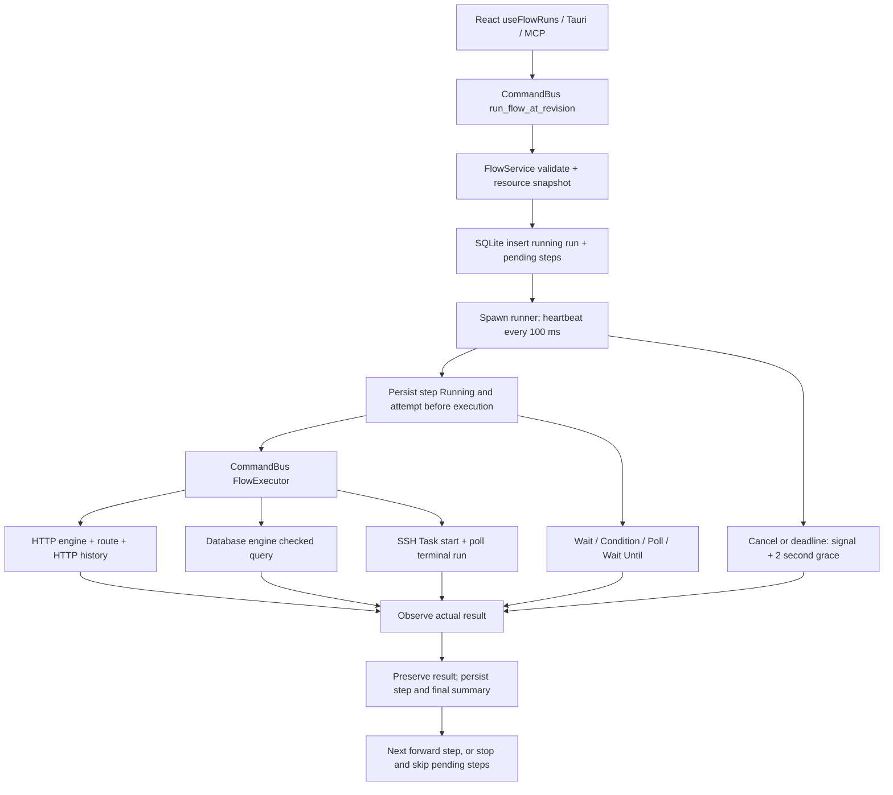

# Flow execution lifecycle audit — 2026-11-15

Scope: current `main` working tree; Flow V1 runner, CommandBus capability bridge,
SQLite run journal, and React run viewer. No schema changes, Job Engine, replay,
new retry policy, or changes to old completed run snapshots.

## Execution chain

There is no general Loop node in V1. Condition and `next` edges must point
forward. Poll and Wait Until are bounded read probes; no action retry is added.
API probes require GET/HEAD, database probes require a read-only connection,
SSH probes are rejected. Wait Until's existing `retryTransientErrors` policy
only applies to those validated probes.

## Current states and transition contract

The table distinguishes the existing wire states from their execution meaning.
`failed` with `FLOW_OUTCOME_UNCERTAIN` is the existing compatibility encoding;
the UI and summary projection display it as outcome uncertain.

| Trigger / initial state | Step result | Run result | Repeat policy |
| --- | --- | --- | --- |
| Invalid definition/input/snapshot before execution | skipped | validationFailed (or synchronous rejection) | Fix input; no action was launched |
| Valid start | pending → running | running | Starting again creates another independent run |
| Complete API response below 400, DB result, SSH confirmed success | succeeded | succeeded after all reachable steps | Explicit rerun repeats effects; not automatically safe |
| HTTP 4xx/5xx, SQL statement rejection, SSH nonzero exit | failed with domain result | failed; later steps skipped | Check prior successful steps before rerun |
| Cancel before capability dispatch / during local wait | cancelled, or pending → skipped | cancelled | Only unstarted work is known not to have run |
| Cancel while remote result arrives during grace | succeeded or definite failed, preserved | cancelled before next step, or failed; a final completed step can finish the run | Cancellation does not undo the completed operation |
| Local wait/probe interval deadline with confirmed clean stop | timedOut | timedOut | No operation remains in flight in this case |
| Remote operation has no result when grace expires | failed + FLOW_OUTCOME_UNCERTAIN | failed + FLOW_OUTCOME_UNCERTAIN | Inspect remote state; never automatic retry |
| HTTP action transport timeout/disconnect/response limit; DB action lost-result error | failed + FLOW_OUTCOME_UNCERTAIN | same; later steps skipped | Inspect remote state; error does not prove rollback |
| SSH cancelled or exit result unavailable | failed + FLOW_OUTCOME_UNCERTAIN | same | Inspect remote task effects |
| Result journal fails after successful Action | succeeded with known output | interrupted + FLOW_HISTORY_WRITE_FAILED; later steps skipped | Fix storage and inspect effects before a new run |
| Result journal fails after definite failed/uncertain Action | original failed/uncertain outcome preserved | original failed/uncertain outcome | No retry |
| Successful Action exceeds output/history size budget | succeeded with bounded `outputOmitted` marker | interrupted + original budget code; next steps skipped | Inspect effects before a new invocation |
| API history or capability Activity recording fails | actual capability outcome + warning | actual result propagated | Never reinterpret as an execution failure |
| SSH terminal log cannot be read | actual success/failure + FLOW_SSH_LOG_READ_FAILED | actual result propagated | Log loss does not invalidate exit status |
| Runner disappears / all final persistence fails | last durable snapshot retained; running decoded interrupted after 30 second lease expiration | interrupted / FLOW_INTERRUPTED | Unknown in-flight effects must be checked; no replay |

Natural HTTP/DB transport errors do not carry a precise dispatch phase. The
bridge conservatively marks action outcomes uncertain. Explicit preflight,
safety, resource revision, SQL statement, pool-acquisition and definite SSH tunnel setup
errors keep their failure classification. `SSH_TUNNEL_TARGET_UNREACHABLE` and
`SSH_TUNNEL_TEMPORARY_UNAVAILABLE` can also occur after an earlier redirect hop;
they are therefore uncertain for actions. Read-only probes keep their
existing transient error policy.

## Findings and fixes

### F1 — P1: local journal failure replaced completed Action outcome

Before: `attempt()` used `persist_run(...).await?` after observing the executor
result. That local database error became the Action error, overwriting a known
success or a domain failure. The outer task also marked journal failures as
`failed`.

Evidence: `flow_history_write_failure_does_not_rewrite_completed_action` installs
a temporary SQLite trigger rejecting intermediate result writes while allowing
the terminal summary. Before the fix, the successful-action case failed with
`left: Failed, right: Interrupted` (0 passed / 1 failed). After the fix the same
test passes for both success and definite failure, with one capability call and
the next step skipped. No external effect is replayed to repair history.

After: completed Action evidence survives; a successful action plus a failed
journal stops scheduling and reports `interrupted/FLOW_HISTORY_WRITE_FAILED`.
Definite domain failure and uncertainty remain primary. Probe journal failures
stop the probe instead of entering the existing transient retry policy.

### F2 — P1: natural transport loss did not expose uncertain effects

Before: only runner abandonment or API cancellation became
`FLOW_OUTCOME_UNCERTAIN`. Natural HTTP error/timeout and DB lost-result errors
became ordinary failure, despite the operation possibly having committed.

After: HTTP action transport errors and response-size truncation, and DB action
timeout / I/O / protocol / TLS / worker-loss errors use the existing uncertainty
encoding. Determinate errors are retained. Real TCP regression
`flow_http_disconnect_after_remote_effect_is_uncertain_without_retry` accepts a
POST, records one fixture effect, then closes the connection without a response;
Flow records uncertainty, attempts once, and skips the next step.

### F3 — P1: SSH log read failure replaced confirmed exit result

Before: `flow_ssh_terminal()` used `read_ssh_task_run_log(...).await?` before
examining the known terminal status. Missing/inaccessible diagnostics could
turn success into failure or hide a real nonzero exit.

After: known success/failure survives; diagnostic loss is a stable warning.
Uncertainty still takes priority. `flow_native_ssh_log_failure_preserves_remote_exit_status`
uses actual russh client/server transport, exit 0 then exit 1, and a SQLite
trigger invalidating log access after terminal persistence. Both outcomes are
preserved; exactly two explicitly requested commands execute.

### F4 — P1: output/history size limit replaced completed Action outcome

Before: a successful executor result over 256 KiB, or aggregate history over
4 MiB, was returned as `FLOW_OUTPUT_TOO_LARGE` / `FLOW_HISTORY_LIMIT` and changed
the Action status to failed. `flow_action_output_budget_preserves_success_and_stops_further_effects`
reproduced this before repair (`left: Failed, right: Interrupted`).

After: the Action stays succeeded, its oversized output is replaced by a bounded
`outputOmitted` marker, and Flow stops as interrupted with the original budget
code. No subsequent effect runs. Definite failed/uncertain Action results keep
their real error even when diagnostics must be omitted. Read-only probe budget
semantics are retained. The UI explains the local limit and asks users to check
remote state before repeating a run.

## Verification evidence

| Check | Result / meaning |
| --- | --- |
| `cargo test -p unfour-command-bus --features ssh-native --lib flow -- --nocapture` with local-loopback access | PASS, 79 tests after output-limit repair, including actual HTTP, SSH/SFTP protocol transport and temporary SQLite |
| Same command in default network-restricted sandbox | FAIL: connections never reached loopback fixtures; terminated stalled accept. Reran with approved local-loopback access above |
| `flow_history_write_failure_does_not_rewrite_completed_action` before / after repair | FAIL before, PASS after; temporary SQLite fault injection |
| `flow_action_history_budget_preserves_known_success_and_failure` | PASS, one test covering both known outcomes after 4 MiB argument expansion; one attempt and no later step |
| `flow_http_disconnect_after_remote_effect_is_uncertain_without_retry` final rerun | PASS with local-loopback access after bounding fixture accept to 5 seconds |
| `node node_modules/vitest/vitest.mjs run packages/flow/src/RunView.test.tsx packages/ui/src/i18n.test.ts` | PASS, 6 tests; history failure hint and successful step rendering |
| `node node_modules/eslint/bin/eslint.js packages/flow/src/runStatus.ts packages/flow/src/RunView.test.tsx` | PASS |
| `cargo test -p unfour-flow-engine` | PASS, 8 unit tests and doc tests |
| `cargo fmt -p unfour-flow-engine -p unfour-command-bus --check` | PASS at the first completed repair checkpoint; final aggregate check recorded in the main audit |
| `node scripts/check-large-files.mjs` | PASS, zero blocking files; existing size advisories retained |
| `pnpm exec ...` in restricted sandbox | NOT RUN: pnpm bootstrap symlink EPERM; existing local node tool binaries used successfully |

The Flow test run includes normal mixed HTTP → Condition → native SSH → SQLite,
HTTP status errors, actual HTTP response after cancellation, unanswered HTTP
cancellation, SSH disconnect before exit status, middle-step failure, local
delay/probe timeout, typed transient probe handling, no backward branches,
secret redaction, stale-run recovery without replay, Activity failure and manual
SSH Run Again. Mock executors only establish scheduler ordering and the explicit
2-second grace contract; the transport tests establish their separate boundaries.

## Remaining limits and P2 candidates

- No P0 found in this Flow review.
- Real PostgreSQL/MySQL server timeout, cancellation acknowledgement and commit
  ambiguity are NOT VERIFIED here. Typed adapter classification is not evidence
  of a remote database rollback or termination.
- Real production SSH shells, network partitions, process survival after channel
  closure, bastion connections and operating-system kill/restart were NOT
  VERIFIED. The isolated SSH protocol server confirms transport/result plumbing,
  not a real shell's process-tree semantics. Bastion implementation is unchanged.
- A permanently unavailable local database cannot durably store a new warning;
  stale recovery retains the last snapshot and reports interruption. No storage
  repair changes old completed side-effect history.
- HTTP error status is a confirmed response, not proof that a server performed
  no side effect before returning an error. Manual rerun is a new invocation.
- P2: extract the bounded result-journal classification into a small
  Flow-specific helper for readability; keep the capability bridge and current
  wire states. No universal state machine is warranted.
- P2: present stable capability warning metadata more visibly in the run viewer;
  it currently remains available in the recorded output JSON.
