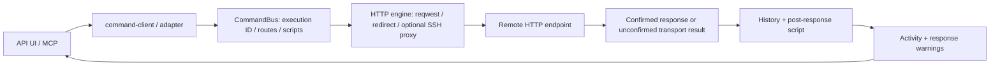
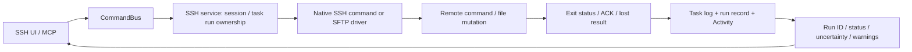
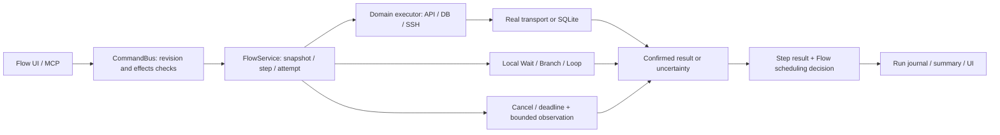

# Execution Lifecycle & Outcome Consistency Audit

审查日期：2026-11-15（Asia/Shanghai）。起点：本地 `main`，
`adbb553641b733d9223c9b21b8f3b92b66bfe573`。本报告区分起点缺陷与工作树修复；
未修改已有业务历史、数据库迁移、公开状态枚举或 Flow V1 产品范围。
未引入通用 Job Engine、自动重试或自动恢复。

完整领域契约、状态转换表及逐项测试见：

- [API](execution-api-audit-2026-11-15.md)
- [SSH / SSH Tasks](execution-ssh-audit-2026-11-15.md)
- [Flow](execution-flow-audit-2026-11-15.md)

## 判定口径

“本地执行已停止等待”不能推出“远端未执行”。HTTP 错误响应、SSH 非零退出码是
已确认的协议/命令结果，也不证明此前的业务副作用已回滚。取消请求本身不是取消完成。
只有发送前被阻止或本地 Delay 等无外部操作的步骤，才能断言未启动外部执行。

History / Activity / 输出日志是执行结果的记录。记录故障不能覆盖已收到的响应、退出码
或已确认的步骤结果。继续调度需要可靠日志时可以中断 Flow，但不能把已成功步骤改成远端失败。
不同领域继续使用自己的状态及既有错误码；不确定性通过既有 error/warnings 表达。

## 三类链路

## 重试行为契约

| 证据 | 可以做什么 | 不能声称什么 |
| --- | --- | --- |
| 校验/权限/发送前连接失败，证明没有发送 | 修正原因后显式重试 | 不能把其他执行 ID 的结果套用到本次 |
| 完整 HTTP 响应 / SSH exit status / DB result | 按领域结果决定下一步；Run Again 是新的执行 | 非零/4xx/5xx 不表示无部分副作用 |
| 执行期间 timeout / cancel / transport loss，没有完整结果 | 提示检查远端状态，再由用户决定是否重新执行 | 不能说未执行、已回滚或远端一定已停止 |
| 成功后 History / Activity / log 失败 | 保留成功并返回记录告警；修复本地记录问题 | 不能自动重新发送写请求或重跑任务来“补日志” |
| Flow 当前 Step 成功，但 Flow 已收到取消 | 保留 Step success，停止后续调度 | 不能把该 Step 强制改成 cancelled |
| 重复点击 / Run Again | UI 防重复、active execution ID 防重；显式重跑分配新 run | 这些不是跨进程 exactly-once 或远端幂等保证 |

这些是操作规则，不是新引入的共同状态机。现有 Wait Until / Poll 的受约束只读探测循环
仍保留；它不是对不确定写操作的自动重试。

## 已确认问题与修复

未发现有证据的 P0。以下为需要修复的 P1 类问题；精确代码与复现用例见领域报告。

| 编号 | 起点问题 | 修复方向与证据 |
| --- | --- | --- |
| API-1 | 完整响应后 History INSERT 失败返回执行错误；等待记录时取消会覆盖响应 | 真实 HTTP + SQLite trigger/锁等待复现；保留响应，独立 History warning |
| API-2 | Post-response 环境变更提交失败丢失已收响应 | 用环境事务故障 fixture；保留响应及脚本失败，不重发 |
| SSH-1 | SFTP publish rename 已在服务端完成但 ACK 丢失，被视为确定失败并尝试回滚 | SFTP 协议故障 fixture；unknown，不基于丢失回执追加回滚/重放 |
| SSH-2 | 并行 Run Again 共享 step ID 构造的暂存文件；本地无覆盖检查存在竞态 | 每次执行独占暂存文件，发布时执行无覆盖约束；真实临时文件测试 |
| SSH-3 | Session transport 已断开，本地 History 失败却返回关闭失败 | 保留 disconnected，使用 SSH_HISTORY_RECORD_FAILED warning |
| FLOW-1 | 已成功/失败的 attempt 被后续日志故障覆盖 | SQLite trigger 先失败再通过；保留 Step 结果，停止后续调度 |
| FLOW-2 | 自然 HTTP / DB transport 错误被当成确定失败 | 非 probe 保守保留未知；HTTP 实传断连 + DB 类型分类验证 |
| FLOW-3 | SSH Task 已结束，读取日志失败覆盖其确定状态 | native SSH + 丢失日志测试；独立 diagnostic warning |
| FLOW-4 | Action 成功后输出/历史预算超限，成功结果被覆盖 | 保留成功及明确的输出省略标记，中断后续调度，保留原预算错误码 |
| MCP-1 | scripted API 的 `httpErrorCode` 被压成 HTTP_ERROR；取消收尾窗口忽略已完成结果 | 保留既有错误分类、确认结果；向未知结果补静态安全提示 |
| MCP-2 | saved API 已有 HTTP response 时，适配层丢弃 Post-response Script 失败/超时状态 | 保留 HTTP success，使用固定脚本失败/超时 warning；真实 HTTP + 脚本抛错/超时测试 |

SSH Tunnel 目标错误也可能来自重定向后续 hop；API、Flow 和 MCP 对相关失联码保守提示
不确定，不能仅凭 `SSH_TUNNEL_` 前缀断言请求未发送。隧道连接实现保持不变。

## MCP 与跨层补充证据

`crates/unfour-mcp/src/command_bus_adapter_tests/execution_outcomes.rs` 使用真实
`TcpListener`，分别经 ad-hoc 和 saved API 工具调用发送 POST。服务端接收后延迟响应
或声明较大 Content-Length 后断连。断言 API_TIMEOUT / HTTP_ERROR 分类、远端副作用
可能已发生的提示、无第二次请求及诊断不暴露 URL。该 fixture 不模拟 reqwest 返回值。

`call_control::tests::cooperative_cancellation_preserves_confirmed_completion` 用可控通知
验证取消后的观察窗口保留 success 和已确认 HTTP 错误。它是调度契约测试，不能代替传输验证。
原有 `stdio_cancels_unlimited_http_at_execution_layer_and_remains_responsive` 还验证真实
HTTP 连接被关闭、MCP 控制消息仍可响应、队列中取消的变更未执行。

最终执行：`cargo test -p unfour-mcp --lib` **PASS，294 tests**，启用默认 native SSH feature。
包含新增真实 HTTP 用例、取消契约、stdio 取消和现有 adapter / policy 回归。
脚本结果告警定向检查 `cargo test -p unfour-mcp --lib execution_outcomes` **PASS，3 tests**：
其中一项分别执行抛错与超时的 Post-response Script，确认 HTTP 201 保留、warnings 可辨别脚本
结果且原始脚本错误的 canary 不泄漏。这 3 项已包含在最终全库 294 项内。

提交前独立复核发现并修复一个额外取消窗口：Post-response 环境事务已提交、后续 cleanup
等待时取消，原实现返回 `Skipped` 并丢失脚本 console/tests。现在只让脚本准备/运行参与取消
竞争，持久化开始后等待确认结果。真实 SQLite 单连接池阻塞 cleanup 的确定性回归先
FAIL（Skipped != Success）后 PASS。API/SSH/Flow 独立复核结束后无剩余阻塞发现。

保存请求读取发生在 execution ID 注册之前的取消窗口也做了代码复核：`cooperative` 中
`cancel()` 返回 false 时直接丢弃 future，不继续 poll；不会在这个窗口继续发送请求。
这属于边界代码复核，未另造专门的读取事务取消 fixture。

各领域最终证据汇总（重叠测试不累计）：

| 范围 | 已通过检查 |
| --- | --- |
| API | HTTP engine 65 + 追加 SOCKS redirect 1；最终 CommandBus `--features ssh-native --lib api_` 49；前端 69 |
| SSH | native engine 152；最终 Session 关闭/取消 history 故障 native 回归 1；前端 84 |
| Flow | native Flow 79 + 历史预算补充 1；Flow engine 8；前端/i18n 6 |

SSH 全库测试先于最后 Session warning 修改；该最后修改已单独通过真实 native 回归。
每条准确命令和测试边界见对应领域报告。

测试过程中的失败也保留说明：

- 首次默认沙盒真实 TCP 用例 **FAIL**：本机连接被阻止，返回 NETWORK_ERROR；使用获准的
  loopback 测试环境重跑后通过，不能把初次失败视为产品传输结果。
- 新 MCP fixture 初次实传 **FAIL**：对请求行错误假定必须为 `/commit`，实际现有引擎发送
  `/commit?`。修正 fixture 对空 query 的接受条件后通过；没有为此改变产品 URL 行为。

## P2 候选与验证边界

跨层检查：desktop TypeScript `tsc --noEmit` PASS；变更 TS/TSX 的 ESLint PASS
（0 errors，API/SSH 既有大型函数及新分支共 5 个长度/复杂度 warning）；
`cargo check -p unfour --features ssh-native` PASS。大文件检查 0 blocking；其结构性
P0/P1 标签不等同于本报告的行为缺陷等级。
最终相关 crate rustfmt、`git diff --check`、4 份审计报告的本地链接检查均 PASS。

仅可读性候选：在领域内提取执行结果与记录告警的小型命名 helper；为已存在的 timeout/
cancel/unknown 分支增加注释；将本报告的复现命令纳入对应领域维护入口。
不建议为了统一名称重写状态枚举或扩大 Flow scope。

真实验证覆盖 HTTP loopback、native SSH loopback、SFTP 协议和临时 SQLite / 文件。
它们验证本次代码的真实传输路径，但不是任意公网服务、OpenSSH 版本或生产数据库的验收。

**NOT VERIFIED**：真实 PostgreSQL/MySQL 提交后断链、真实远端进程在客户端断开后继续存活
的时长、未验收堡垒机路径、操作系统进程强杀/断电后的最终持久化、桌面原生 UI 手工点击。
Mock 与类型级测试通过不改变这些边界。永久存储故障仍无法保证最后结果落盘；重启后可能
只能恢复为 interrupted / unknown，不能宣称完整持久化。

用户已有未跟踪 `docs/architecture/DSH_PLUGIN_FEASIBILITY.md`，以及并行工作生成的 `.tmp/`、
`scripts/poc/` 和其他 SQLx 评估文档/证据，均保持原样且不纳入本次提交。本次未推送。
