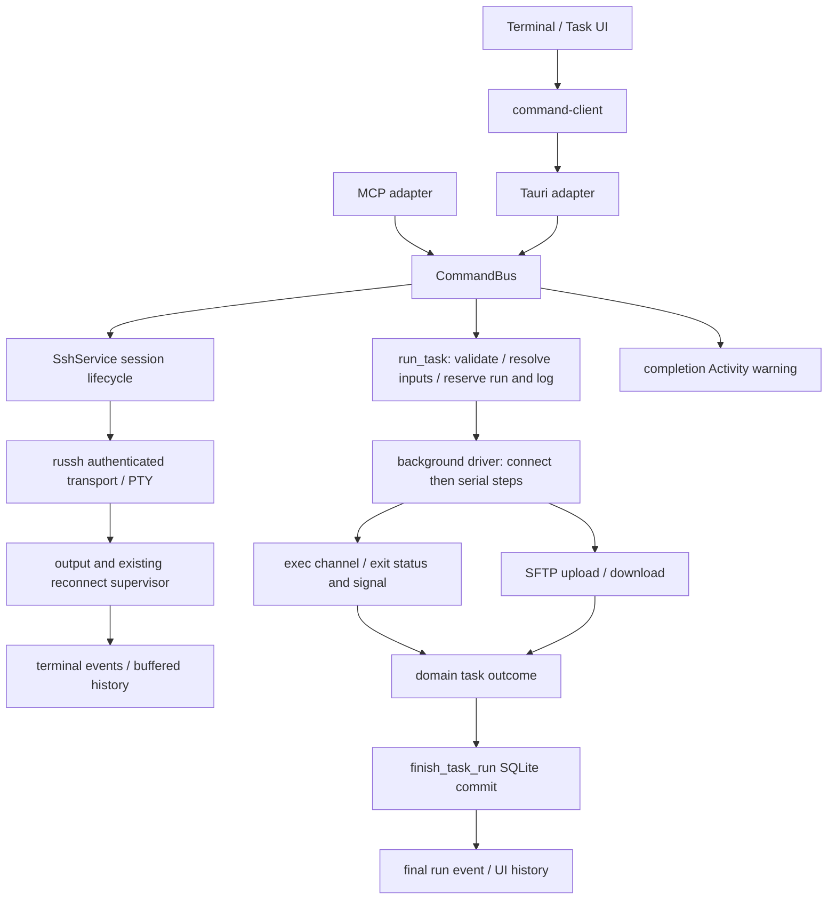

# SSH / SSH Tasks execution outcome audit — 2026-11-15

Baseline: `main`, `adbb553641b733d9223c9b21b8f3b92b66bfe573`. This report distinguishes baseline behavior from the changes in this working tree. No public schema, persisted status, task definition, command replay policy, or bastion connection implementation is changed.

## Execution chains

Task execution starts only after validation and insertion of a `running` record with an owner lock. Cancellation sends a watch notification; the cancel response is an acknowledgement and can still contain `running`. The caller waits for the terminal run event or record. Session connectivity does not certify that an interactive remote command completed.

## Existing state contracts and repaired transitions

### SSH Session

| Condition | Baseline result | Current result / retry contract |
| --- | --- | --- |
| Before connection | no live session; UI connecting request | unchanged; connection failures can be retried after checking credentials / trust |
| Authenticated PTY established and history initialized | `connected` | unchanged; not a remote-command success signal |
| Unexpected transport closure | `degraded` → `reconnecting` → `connected` or `failed` | existing bounded 1/2/4 second reconnect remains; no queued shell command replay is added |
| Explicit close / cancel reconnect | resources detached, cancel signal sent, `disconnected` | unchanged; session closure does not prove a remote process was killed |
| History flush/update fails after close | resources closed but public call returned `Err`, frontend could retain close-failure presentation | **fixed:** `disconnected` plus response-only `SSH_HISTORY_RECORD_FAILED`; UI warning and terminal close event retain the history warning |
| Initial history creation fails while connecting | connection torn down and original error returned | unchanged: no usable connected session is handed to caller |
| Activity recording fails after connect/close | result plus `ACTIVITY_RECORD_FAILED` | unchanged; do not repeat the connection operation to repair an activity entry |

### SSH Task / step

There is no new common state machine. The existing string statuses remain `running`, `success`, `failed`, `cancelled`. `SSH_TASK_OUTCOME_UNCERTAIN` is carried in `error_message` / event error, and the UI derives `outcomeUncertain` from it. A timeout is not a new persisted status.

| Phase / evidence | Persisted / event state | Meaning and explicit retry contract |
| --- | --- | --- |
| Input validation, local path checks, run/log creation not complete | no dispatched run or command error | correct the preflight condition; no remote command was dispatched by this attempt |
| Run reserved; connect / active step / outcome commit pending | `running` | cancellation is a request, not proof of remote termination |
| Command exit status 0 | step `success` | confirmed exit; full output may still be truncated; retry is a fresh execution |
| Nonzero exit status or exit signal | step `failed`, code/signal retained | confirmed command failure, but command may already have partial side effects; inspect before replay |
| Explicit command `continueOnError` | failed step retained, subsequent steps execute; whole task can be `success` | existing task policy; task success means the configured sequence completed, not every step succeeded |
| Cancellation before dispatch | `cancelled`, no uncertainty marker | confirmed not dispatched for this step; earlier task steps may have completed |
| Cancellation after dispatch without exit confirmation | `cancelled` + `SSH_TASK_OUTCOME_UNCERTAIN` | inspect remote state; never infer rollback or automatic replay |
| Command timeout, transport loss, or channel close without exit status | `failed` + `SSH_TASK_OUTCOME_UNCERTAIN` | no proof that the remote process terminated; must inspect before rerun |
| Already queued exit status races cancellation/timeout | confirmed exit wins | existing bounded queue drain retains known success/failure; subsequent steps still obey cancellation |
| Upload rename ACK missing after remote mutation | baseline plain `failed`; backup errors were swallowed and could lead to further rename/rollback | **fixed:** uncertainty marker; stop further publishing/rollback on an unknown rename result |
| Upload staging / copying fails | failure/cancel, target not yet published | cleanup owns only this attempt's staging; failed cleanup is uncertain; no claim that no remote temporary write occurred |
| Download finishes / publication succeeds | `success` | **fixed:** exclusive local staging, atomic overwrite/no-clobber publication, independent of another run's step ID |
| Task outcome SQLite update fails | existing runtime retains known outcome and owner, retries only status write; durable row remains `running` until commit | never reexecutes steps; permanent store outage can leave the UI waiting (see limitations) |
| Task log output write fails | best-effort writer does not change execution result | current limitation: per-line write failures are not surfaced as run warnings; lack of a log is not proof of nonexecution |
| Process dies while run owner disappears | `failed` + `SSH_TASK_RUN_INTERRUPTED` on existing recovery read | remote state requires inspection; no task replay |
| Run Again / independent API invocations | fresh run IDs and logs; current definition runs from the first enabled step | not idempotent; intentional duplicate invocations execute twice. Frontend has a synchronous single-flight start guard; historical runs remain unchanged |

There is no “timeout with confirmed remote termination” result merely because a timer fired. A confirmed exit signal can prove command termination, but does not prove that earlier external writes were rolled back.

## Findings and fixes

No P0 was established in this scope.

1. **P1 — upload publication uncertainty was reported as definite failure.** `task/upload_step.rs::replace_remote_file` used `.is_ok()` for the backup rename and emitted `Failed("finalize remote upload failed: Timeout")` when a later ACK was lost. The new regression was run before the fix: expected `OutcomeUncertain`, received that `Failed` value (1 failed test). The repaired TCP SFTP fixture performs actual renames on temporary files, then withholds the reply. Both lost-backup-ACK and lost-publication-ACK now return uncertainty; the test checks the original backup, published new contents where applicable, and exactly one/two mutation calls with no rollback or replay. A definite server rejection still returns a failure; a failed restoration after such a rejection is uncertain.

2. **P1 — concurrent runs shared transfer files by definition step ID.** Baseline upload, download and backup names were derived from `step.id`; `create` could truncate another run's partial file and cleanup could remove it. Upload now uses an attempt UUID plus exclusive SFTP create. Download uses the existing optional `tempfile` dependency to own an exclusive sibling, and publishes with `persist` / `persist_noclobber`. A concurrent local fixture verifies distinct staged paths, exactly one no-overwrite winner, intact winner bytes and no leftover owned files. Public paths and task configuration remain compatible. This change does not promise destination-level serialization for explicit overwrite runs.

3. **P1 — a completed session disconnect was returned as an execution error when history failed.** The existing native test deliberately injected SQLite UPDATE failure, verified the transport had closed, then expected `Err`. The revised native test verifies close and reconnect cancellation return `disconnected` with `SSH_HISTORY_RECORD_FAILED`, retain no live session, and do not reconnect. Response warnings reuse the existing optional warnings array; no schema migration or old history rewrite. English/Chinese UI copy and a rendered React test verify the disconnect and history warning are presented separately, with no second close/connect call.

4. **Verification defect — an existing test could hang forever when loopback was unavailable.** `reruns_create_independent_records_and_logs_without_modifying_original` waited for an unbounded acceptor even when both attempts failed before reaching TCP. The acceptor await is now bounded and reports both real connection errors. This changes only the fixture.

## Verification evidence

All local data is disposable SQLite / temporary files; network endpoints bind `127.0.0.1:0`. No saved user workspace or real SSH host is used.

| Command / test | Result | Evidence level |
| --- | --- | --- |
| Initial `cargo test -p unfour-ssh-engine --features ssh-native lost_upload_rename_ack -- --nocapture` before fix | **FAIL (expected regression)** | SFTP request/reply byte stream, timeout returned as definite failure |
| Initial default-sandbox task suite | **NOT COMPLETED**, interrupted after 48 passing cases and a blocked loopback acceptor | environment prevents loopback; not native-transport success evidence |
| `cargo test -p unfour-ssh-engine --features ssh-native task -- --nocapture` outside sandbox | **PASS, 49** | command result unit cases, local SQLite history trigger, real loopback connect failure, SFTP lost ACK and concurrent local publication |
| `cargo test -p unfour-ssh-engine --features ssh-native --lib -- --nocapture` outside sandbox | **PASS, 152** | engine coverage including session scoping, channel lifecycle, real tunnel transport tests and SFTP protocol fixtures; before the final close-warning change |
| `cargo test -p unfour-command-bus --features ssh-native --lib flow` outside sandbox (Flow audit) | **PASS, 78** | includes real russh SSH auth/exec/PTY, Activity failures, Run Again, disconnect after exec, API→SSH→SQLite; before revised close-warning assertions |
| `cargo test -p unfour-command-bus --features ssh-native --lib native_history_persistence_failure_releases_the_session -- --nocapture` outside sandbox | **PASS, 1** | rerun after close/cancel-warning change; true russh TCP plus SQLite failures |
| `node node_modules/vitest/vitest.mjs run` for `useSshTaskRunSession`, `useTaskRunDialogState`, `task-run-events`, `TaskRunPanel`, `ssh-connection-state` | **PASS, 78 / 5 files** | frontend state, late selection/start results, single-flight and uncertainty display; not transport evidence |
| `node node_modules/vitest/vitest.mjs run packages/ssh-terminal/src/TerminalPage.activity.test.tsx` | **PASS, 6** | UI connection/close Activity warning and history warning semantics |
| ESLint changed SSH frontend files | **PASS, 0 errors**, 2 existing size warnings | `TerminalPage.tsx` function/file size warnings |
| `cargo fmt -p unfour-ssh-engine -- --check`; scoped `git diff --check` | **PASS** | formatting / whitespace |

The `pnpm exec vitest` launcher initially failed with sandbox symlink `EPERM`; invoking the already-installed local Vitest entrypoint ran the same suite without installation or dependency changes. Rust warnings from vendored SQLx lifetimes / release-channel default were present and are unrelated.

## Limits and follow-ups

- **NOT VERIFIED:** production OpenSSH daemon behavior, arbitrary remote shells, process trees surviving channel closure, and OS/network power loss. The native loopback server is a controlled real russh peer; it does not spawn a remote shell.
- **NOT VERIFIED:** full SSH-encrypted upload/download of the modified task transfer path against a production SFTP implementation. The rename regression uses real SFTP packets over loopback TCP and real fixture files; existing native SSH tests separately establish the SSH transport and command path. Do not describe this as production SFTP acceptance.
- **NOT VERIFIED:** actual disk-full log file writes; `TaskLogWriter` currently swallows per-line I/O errors. This is a record-observability limitation, not evidence of command success/failure corruption. Outcome SQLite failure is tested by a trigger; existing commit retries are unchanged and can wait indefinitely during a permanent outage.
- Interactive terminal input acceptance is not execution completion. Existing reconnect recreates the PTY without replaying commands; a production reconnect sequence and remote process survival still need a controlled remote-host exercise.
- One-shot `run_command` / diagnostic capture is separate from Task execution: it retains nullable exit status and `truncated`, and still stops capture at EOF. A result with no exit status must not be interpreted as confirmed success. The Task reader correctly waits past EOF for exit status; this audit does not unify these readers.
- A confirmed upload can leave an obsolete backup if backup cleanup fails; the destination outcome is known. No recovery/retry feature was added.

Readability-only P2 candidates: document the distinction between “task sequence success” and `continueOnError` step failures at the runner; rename internal copy/commit locals for the publication phase; link one-shot command and Task result contracts beside their separate readers. These do not justify merging status models or introducing a shared execution engine.
