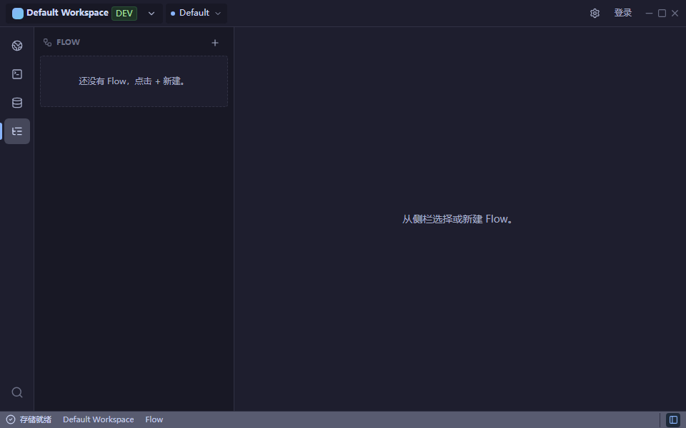
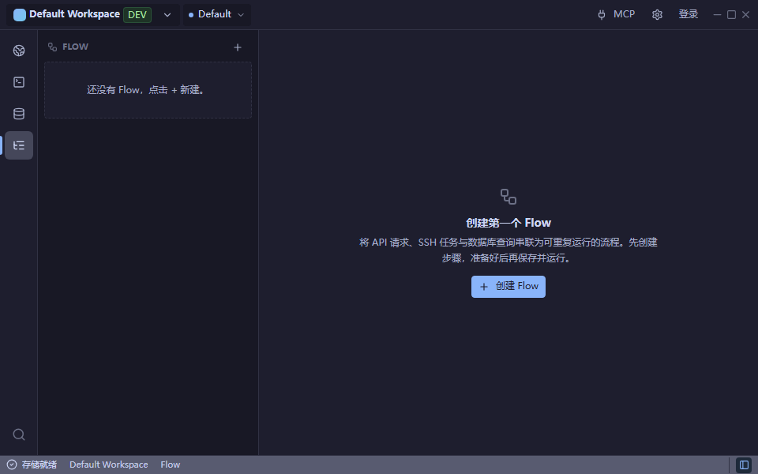

# Desktop UI/UX audit — 2026-10-13

基线：`88793e0f`（开始时 fetch 后的最新 `origin/main`），直接在 main 修改。开始时工作区干净。

本轮完成三组优化：全局功能发现、Flow 首次使用状态、MCP 状态恢复。没有新增依赖，没有更改 Rust、CommandBus、MCP 权限、Cloud Sync 协议或业务持久化。

## 方法与覆盖范围

先阅读 `design.md`、`docs/ui/design-system.md`、`docs/ui/interaction-guidelines.md`，再检查 App Shell、Workspace、SSH、Database、API Client、Flow、MCP 和文件导入导出的现有实现。

参考 [VS Code 的界面与命令面板说明](https://code.visualstudio.com/docs/editing/getting-started/userinterface)，借鉴“固定工具区、可搜索命令、保留编辑上下文”的做法；Unfour 的三个设计文档仍是设计依据。没有增加欢迎仪表盘、卡片导航或新的 Token。

运行 Vite + Chromium，使用仓库自带 browser mocks 和测试专用 fixtures，不操作真实连接和用户数据。修改前后各采集 42 张相同场景截图：

- 960×600：英文/中文 × 浅色/深色四种组合。
- 1440×900：英文浅色、中文深色两种组合。
- 每组覆盖 API、SSH、Database、Flow、MCP、Workspace 菜单、导出对话框。
- 导入预览、MCP 权限文案、路径/凭据提示由既有 Workspace bundle Playwright 用例验证。
- 额外覆盖 MCP 读取失败与恢复、Flow 加载/失败/空数据/未选择、长列表滚动、未保存草稿保持、键盘命令、Flow 失败运行与长诊断文本。

960×600 是比原生窗口最小值 1040×680 更严格的浏览器压力场景。没有将浏览器结果冒充原生 Tauri 验证；没有穷举所有主题/语言/尺寸/业务状态的笛卡尔积。

## 问题与取舍

| 优先级 | 观察与证据 | 用户影响 | 成本/风险 | 决策 |
| --- | --- | --- | --- | --- |
| P1 | Flow 主区域只显示“从侧栏选择或新建”，无用途说明、直接操作；无草稿时主区域不区分列表加载失败与未选择 | 初次访问不知道可以组合哪些能力，侧栏收起时下一步不明确 | 低/低，复用创建草稿与选择处理函数 | 已实现 |
| P1 | 命令面板缺 Flow、Settings、MCP；MCP 需先找到齿轮再切设置分类 | 特色功能难发现，键盘路径不完整 | 中/低，设置状态仅提升到 Shell 组合层 | 已实现 |
| P1 | MCP 状态初次读取失败后没有重试入口；安装/修复本地二进制后无法在原地复查 | 用户只能退出重进，失败与“未安装”容易混淆 | 低/低，仅重读已有命令 | 已实现 |
| P2 | Workspace 文件操作虽已存在菜单和命令面板，但菜单没有展示资源范围 | 容易与 API 集合导入导出混淆 | 低/低，补充说明文字 | 随功能发现优化实现 |
| P2 | Database 无连接时同时展示 SQL 编辑区提示、禁用运行按钮、空结果区 | 信息重复，主区缺直接创建连接入口；侧栏 + 可用 | 中/中，需贯穿编辑器与连接弹窗组合 | 下一轮考虑 |
| P2 | SSH `TerminalLogPanel.tsx` 的标题/按钮/空状态含硬编码英文；复制日志直接写剪贴板，无就地成功/失败状态 | 中文体验不完整，复制失败不易辨认 | 低至中/低，但不属于本轮三条核心路径 | 下一轮考虑 |
| P2 | MCP 960×600 的示例提示词和高级命令需滚动；两客户端均使用强调按钮 | 低频内容层级仍可压缩 | 中/低，应结合真实安装状态评估 | 保留现状，后续考虑可折叠高级区 |
| P3 | 大型前端 chunk 构建警告仍存在 | 可能影响模块首次加载，当前无性能预算证据 | 中至高/中 | 先测量，不为审美拆包 |

保留的合理设计：API 请求与响应会按窗口宽度切换方向，空响应有发送入口；SSH 无连接时已有明确新建按钮；各资源侧栏的 + 尺寸和长列表固定头部一致；导入使用预览及安全默认权限，导出解释 secrets/本地路径范围，确认按钮在紧凑窗口可达。没有为了统一外观改变各模块工作方式。

## 本轮实现与可验证收益

1. **全局功能发现。** 顶栏新增紧凑 MCP 文字入口，打开现有设置页；命令面板补 Flow、Settings、MCP。Workspace 菜单为导入和导出增加“API、SSH、数据库、变量和 Flow”说明。MCP 从两次点击降为一次；键盘可直接搜索 Flow/MCP。原齿轮、侧栏、文件操作和导入导出流程保留。
2. **Flow 首次使用。** 用共享 EmptyState/LoadingState/ErrorState/Button 表达加载、失败、无资源、未选择。无资源时提供简短用途说明和“创建 Flow”；有资源时提示选择现有 Flow。主区域可直接重试。创建只生成既有草稿，不保存、不执行。
3. **MCP 就地恢复。** 增加“刷新状态”，并行重新读取已有二进制/客户端状态。读取失败给出可操作提示；刷新期间保留现有客户端信息，禁用重复刷新和配置操作。成功重读会清除旧错误，允许按原有规则配置客户端。

布局仍使用既有字号、间距、语义颜色、Lucide 图标与共享组件；没有更改业务组件所有权。所有新增文案使用共享 i18n 中英文键。

## 同场景截图

截图来自真实 Chromium 渲染，无拼图、修图或模拟界面。以下三组共六张随报告提交；完整 84 张本地矩阵与采集脚本保存在忽略目录 `test-results/ui-audit/`，该目录会被下次 Playwright 运行清理。

| 场景 | 修改前 | 修改后 |
| --- | --- | --- |
| Flow，中文深色，960×600 | [前](ui-ux-2026-10-13/flow-before.png) | [后](ui-ux-2026-10-13/flow-after.png) |
| Workspace 菜单，英文浅色，960×600 | [前](ui-ux-2026-10-13/workspace-before.png) | [后](ui-ux-2026-10-13/workspace-after.png) |
| MCP，英文浅色，960×600 | [前](ui-ux-2026-10-13/mcp-before.png) | [后](ui-ux-2026-10-13/mcp-after.png) |

Flow 修改前：

Flow 修改后：

这里的收益依据是可见下一步、可用入口与状态恢复测试，不是代码行数或未经用户研究验证的“更美观”评分。

## 验证结果

- **PASS**：受影响 Vitest 测试 22 文件、160 用例；随后补充 Flow 加载中回归，单独复跑 FlowPage 53 用例全部通过。合计覆盖 161 个不同用例。
- **PASS**：全部 Playwright 27/27；包括新增中英文 × 深浅主题入口/草稿/焦点用例，以及 MCP 故障恢复。
- **PASS**：修改的 TypeScript/React 文件 ESLint；新增测试最终版本另行复查。
- **PASS**：`pnpm run build`（TypeScript + Vite）；仍有大于 500 kB 的 chunk 警告。
- **PASS**：`pnpm run check:tokens`。
- **PASS**：`pnpm run check:large-files`，0 blocking；既有大型文件仍有分级提示，FlowPage 测试文件也在其中。
- **PASS**：`git diff --check`。
- 首轮 Vitest 曾 **FAIL** 1 项：菜单新增说明导致旧测试直接比较 textContent 失败，已改为按菜单可访问名称核对顺序并复跑通过。
- 首轮定向 Playwright 曾 **FAIL** 1 项：一次性 MCP 故障 fixture 被 React StrictMode 重复挂载消耗，已改为显式控制恢复的 fixture；全量复跑通过。

复现交互：`pnpm exec playwright test --workers=2`。新增用例位于 `apps/desktop/tests/smoke/ui-audit.spec.ts`。

## 边界与下一轮

**NOT VERIFIED**：原生 Tauri 标题栏/系统缩放、实际 MCP 客户端配置文件写入、真实 SSH/数据库连接和网络错误、原生文件选择器。浏览器 mocks 可以证明布局与前端交互，不能证明这些集成路径。未运行 Rust 检查，因为没有改动 Rust 或协议。

下一轮优先：Database 无连接主区的直接创建动作与空结果降噪；SSH 日志面板中英文补齐及复制反馈；真实 Tauri 在 125%/150% 缩放下的键盘、焦点和长路径检查。MCP 高级内容折叠和首屏资源示例需先验证用户是否需要，避免把轻量工作台变成教程首页。
