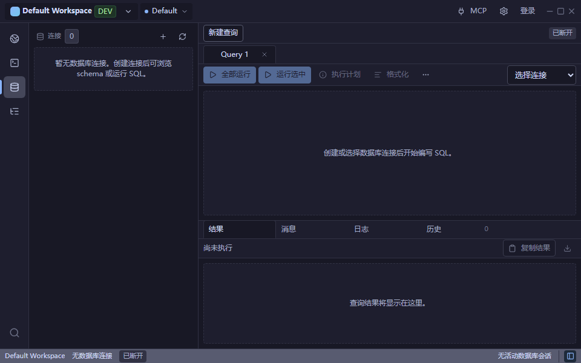
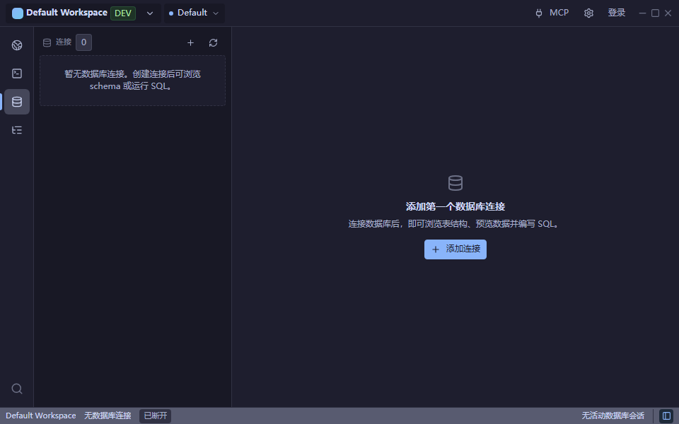

# Desktop UI/UX round 2 — 2026-10-14

基线 `f611957e`：fetch 后确认与 `origin/main` 一致，工作区干净。沿用[第一轮审计](ui-ux-audit-2026-10-13.md)及既有三份 UI 设计规范，直接在 main 实施。

## 本轮问题、优先级与收益

| 优先级 | 问题及证据 | 实现 | 成本/风险 |
| --- | --- | --- | --- |
| P1 | Database 无连接首屏同时显示查询标签、禁用执行按钮、编辑器空状态、结果空状态，主区没有创建动作 | 未使用的初始工作区显示一段用途说明和“添加连接”，复用原连接弹窗；连接加载中、失败、真实空数据分别显示，失败可重试 | 中/低至中；只改变主区呈现 |
| P1 | 浏览器测试发现：取消连接弹窗后，焦点未返回新建入口 | 弹窗记录打开前的焦点，关闭时若原元素仍存在则返回；四种主题/语言组合实测通过 | 低/低 |
| P2 | SSH 日志标题、工具提示、空状态及导出失败提示为硬编码英文；剪贴板缺失时静默无操作，拒绝时无就地反馈 | 使用共享中英文键；复制中禁用重复提交，成功短暂显示反馈，失败持续显示重试提示；导出保持原处理流程，增加等待图标和本地失败提示 | 低/低；不改变日志数据来源与脱敏 |

这轮聚焦两个模块的三项具体体验问题，没有为了数量扩展到其他页面。仍使用共享 EmptyState、LoadingState、ErrorState、Button、IconButton、Toolbar 和现有 Token，不增加依赖。

Database 引导只适用于没有连接、至多一个初始空白查询且没有已有工作内容的状态。有连接上下文、SQL/基线 SQL、结果、错误、运行状态、确认状态、非结果视图或多个标签时，继续显示原工作区。尤其覆盖了“SQL 清空但尚未保存”的草稿，避免空状态隐藏实际工作。

## 视觉与交互证据

运行 Vite + Chromium，使用仓库浏览器 mocks；960×600 下中英文 × 深浅主题，共保存修改前 8 张、修改后 8 张稳定截图。相关浏览器回归还包含 1440×900 与 960×600 间的窗口切换。

| 场景 | 修改前 | 修改后 |
| --- | --- | --- |
| Database 无连接，中文深色，960×600 | [前](ui-ux-2026-10-14/database-before.png) | [后](ui-ux-2026-10-14/database-after.png) |
| SSH 日志空状态，中文深色，960×600 | [前](ui-ux-2026-10-14/ssh-before.png) | [后](ui-ux-2026-10-14/ssh-after.png) |
| 剪贴板失败与重试，中文深色，960×600 | [失败](ui-ux-2026-10-14/clipboard-error.png) | [恢复](ui-ux-2026-10-14/clipboard-recovered.png) |





六张关键截图随报告提交；完整矩阵和临时采集脚本保留在忽略目录 `test-results/ui-audit-round2/`，后续运行 Playwright 可能清理该目录。

可验证的交互结果：侧栏收起时仍能添加连接；取消弹窗返回原按钮；创建入口本身不保存或执行 SQL；复制失败可重试；复制成功的内容包含 `<redacted>` 而不包含测试凭据；底部日志面板仍可收起。

## 检查结果

- **PASS**：相关 Vitest 7 文件、36 用例。覆盖数据库初始加载/失败恢复、连接编辑、SQL 草稿保留、日志复制失败/缺少剪贴板/等待锁定、导出失败恢复、日志脱敏及终端状态。
- **PASS**：相关 Playwright 12/12，覆盖新增四种语言/主题组合、Database 树、现有桌面交互和侧栏一致性。
- **PASS with warning**：修改文件 ESLint，0 errors、1 warning；`DatabasePage` 的函数长度超过已有 300 行阈值，未为消除提示进行无关重构。
- **PASS**：TypeScript + Vite 生产构建；仍有大于 500 kB 的 chunk 警告。
- **PASS**：共享 Token 检查、文件规模检查（0 blocking）、`git diff --check`。
- 首轮 Vitest **FAIL** 7 个新增用例：新增翻译键误放到 `feedback` 命名空间，已移至正确的 `database.start` 与 `ssh.logs`，复跑通过。
- 首轮 Playwright **FAIL** 4 个新增用例：发现真实的连接弹窗焦点丢失，修复组件后完整定向回归通过，没有删除或放松焦点断言。

命令：

```text
pnpm exec vitest run packages/database/src/DatabasePage.start.test.tsx packages/database/src/DatabasePage.test.tsx packages/database/src/components/DatabaseConnectionDialog.test.tsx packages/database/src/components/DatabaseWorkspace.test.tsx packages/ssh-terminal/src/components/TerminalLogPanel.test.tsx packages/ssh-terminal/src/model/terminal-state.test.ts packages/ui/src/i18n.test.ts
pnpm exec playwright test apps/desktop/tests/smoke/ui-recovery.spec.ts apps/desktop/tests/smoke/database-tree.spec.ts apps/desktop/tests/smoke/desktop-ux.spec.ts apps/desktop/tests/smoke/sidebar-consistency.spec.ts --workers=2
pnpm run build
pnpm run check:tokens
```

## 保留边界与下一轮

未修改 Rust、CommandBus、MCP 权限、Cloud Sync 协议、日志内容或持久化格式；没有改动 AGENTS.md。浏览器测试的剪贴板和日志为隔离 fixtures，不读写系统剪贴板或连接真实 SSH/数据库。

**NOT VERIFIED**：原生 Tauri 的系统剪贴板授权、真实 SSH 导出失败、原生缩放 125%/150%。因此不能用本轮浏览器证据证明这些集成行为。

后续候选：SSH 中文侧栏仍保留 Connections/Tasks 英文翻译值；Database 侧栏自身尚未区分初始加载与无连接（本轮在主区明确显示）；紧凑窗口下长错误、长资源名与靠右工具提示应再做针对性检查。原生高 DPI 与键盘遍历验证优先于进一步装饰性调整。
